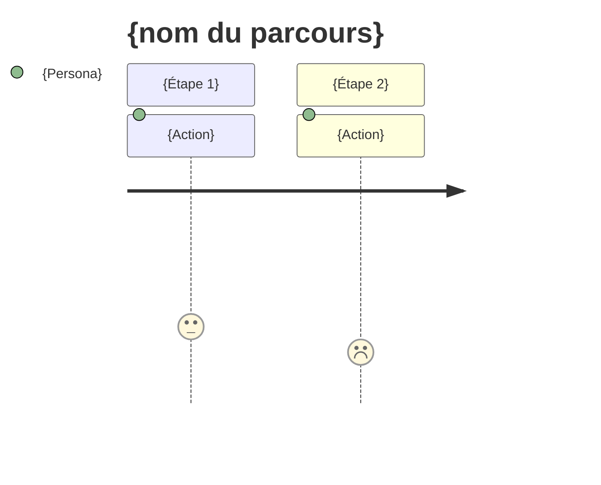

# Customer journey map — {Prénom} (état actuel)

<!-- Un fichier par persona ; une section par parcours. Décrit comment les choses se passent aujourd'hui, reconstitué à partir des récits réels. Chaque cellule cite ses sources [P03]. -->

**Persona** : [{Prénom}](../02-persona/{NN}-{prenom}.persona.md)

## {nom du parcours}

- **Scénario** : {situation précise et objectif de l'utilisateur}
- **Début / fin** : {déclencheur} → {résultat attendu}
- **Statut des données** : {🟢 fondé / 🟡 partiel / ⚪ hypothèse} — fondé sur {P01, P04, A07...}

### Vue d'ensemble

| | {Étape 1} | {Étape 2} | {Étape 3} | {Étape 4} |
|---|---|---|---|---|
| **Actions** | | | | |
| **Points de contact / canaux** | | | | |
| **Pensées** | | | | |
| **Émotions** (😀 / 😐 / 😟) | | | | |
| **Points de friction** | | | | |
| **Opportunités** | | | | |

### Courbe émotionnelle

### Moments de vérité
- {...}

### Priorités d'amélioration
1. {opportunité + impact attendu}

### Hypothèses à valider
- {...}
