# UF-{NN}.{FF} — {tâche : verbe + objet, du point de vue du persona}

> Épopée : [{NN} {Épopée}](../../04-user-stories/{NN}-{epopee}/00-{epopee}.epic.md) · Persona principal : [{Prénom}](../../02-persona/{NN}-{prenom}.persona.md) · Variantes : [{Prénom}](../../02-persona/{NN}-{prenom}.persona.md)
> Stories couvertes : [US-{NN}.01](../../04-user-stories/{NN}-{epopee}/01-{story}.story.md), [US-{NN}.02](../../04-user-stories/{NN}-{epopee}/02-{story}.story.md)
> Stories mobilisées (autres épopées) : [US-{MM}.01](../../04-user-stories/{MM}-{epopee}/01-{story}.story.md) *(si leurs étapes sont dessinées ici ; sinon renvoi `uf1` vers leur flow)*

- **Déclencheur** : {ce qui pousse le persona à agir}
- **Fin** : {le moment où la tâche est réglée pour lui}
- **Points d'entrée** : {notification, courrier, recherche...} — d'après [{parcours}](../../03-customer-journey-map/{NN}-{prenom}.cjm.md#{ancre})
- **Appareil principal** : {mobile / ordinateur / les deux} — d'après « Quand et sur quoi » de la fiche persona

## Diagramme

```mermaid
flowchart TD
    start(["{Déclencheur}"]):::horsApp
    uf1[["UF-{MM}.{FF} {Tâche préalable}"]]
    EC01["EC01 {Écran}"]
    s1[/"{Traitement système}"/]
    d1{"{Décision ?}"}
    EC02["EC02 {Écran}"]
    EC05["EC05 {Écran de l'alternative}"]
    EC09["EC09 {Écran d'erreur}"]:::erreur
    x1["{Étape hors application}"]:::horsApp
    v1["{Prénom} : {étape propre à la variante}"]:::variante
    fin(["{Fin}"])
    fin2(["{Fin : traité par un conseiller}"])

    start ==>|"{action}"| uf1
    uf1 ==> EC01
    EC01 ==>|"{action}"| s1
    s1 ==> d1
    d1 ==>|"Oui"| EC02
    EC02 ==> fin

    EC01 -->|"A1 : {action alternative}"| EC05
    EC05 --> s1
    d1 -->|"E1 : Non"| EC09
    EC09 -->|"{issue : réessayer}"| EC01
    EC09 -->|"E2 : {demande un contact humain}"| x1
    x1 --> fin2
    EC01 -.->|"V1 : {Prénom} {action}"| v1
    v1 -.-> fin

    classDef erreur fill:#fde2e2,stroke:#c0392b,color:#7b241c
    classDef horsApp fill:#f2f2f2,stroke:#888,stroke-dasharray:5 5
    classDef variante fill:#e3f0fc,stroke:#2e86c1
```

<!-- Happy path : flèches épaisses ==> · alternatives et erreurs : --> · variantes : -.-> -->
<!-- Nœuds : écrans = ID d'inventaire (EC05) ; sinon start, fin, d1, s1, x1, v1, uf1. Jamais « end ». -->

## Chemins

| ID | Type | Quand | Suite de nœuds | Issue |
|---|---|---|---|---|
| `HP` | Happy path | {tout se passe bien} | start → uf1 → EC01 → s1 → d1 → EC02 → fin | {tâche réglée} |
| `A1` | Alternatif | {ce qui fait dévier} | EC01 → EC05 → s1 | {rejoint le happy path} |
| `E1` | Erreur | {ce qui échoue} | d1 → EC09 → EC01 | {réessayer} |
| `E2` | Erreur | {le persona ne s'en sort pas seul} | d1 → EC09 → x1 → fin2 | {contact humain} |
| `V1` | Variante {Prénom} | {constat de sa fiche} | EC01 → v1 → fin | {...} |

## Étapes du happy path

<!-- Happy path seulement : les autres chemins sont décrits dans « Chemins ». -->

| # | Écran | Action du persona | Réponse du système | Story |
|---|---|---|---|---|
| 1 | [EC01](../00-index.md#ec01) {nom} | {...} | {...} | US-{NN}.01 |

## Couverture des scénarios

<!-- Stories couvertes : tous leurs scénarios. Stories mobilisées : seulement les scénarios dessinés ici. -->

| Story | Scénario | Chemin |
|---|---|---|
| US-{NN}.01 | {titre du scénario} | `HP` |

## Retours vers le backlog

| Type | Story concernée | Proposition | Statut |
|---|---|---|---|
| {scénario manquant / scénario à revoir / story manquante} | {US-NN.SS / nouvelle} | {...} | {proposé / accepté / refusé} |

## Questions ouvertes
- {...}
