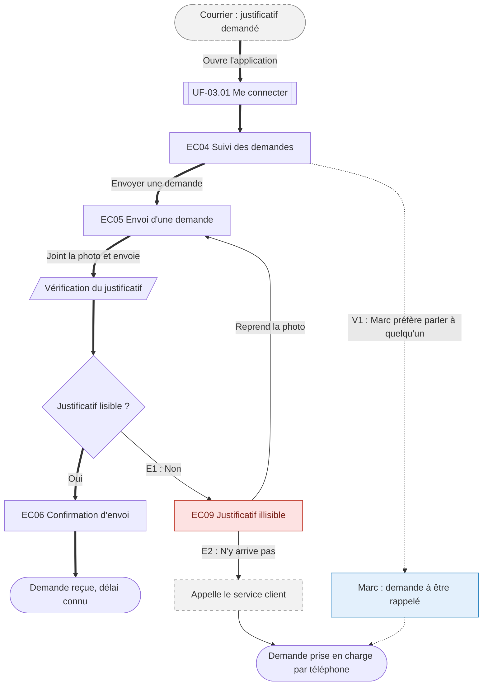

# Exemples commentés — ux-04-user-flows

> Projet fictif servant de fil rouge à tous les skills : l'**espace client** d'une organisation qui traite des demandes de ses clients. Personas : Sophie (veut tout régler sur mobile), Marc (préfère parler à quelqu'un). Ces exemples montrent le niveau de détail attendu. Ne jamais recopier leur contenu.

## 1. Délimiter une tâche

✅ « Envoyer une demande et savoir quand elle sera traitée » — un déclencheur (un courrier réclame un justificatif), une fin (le délai est connu).

❌ « Voir le statut » — un seul écran : c'est une story, pas une tâche.

❌ « Gérer mon compte » — plusieurs objectifs : c'est une épopée.

## 2. Flow complet (`01-faire-une-demande/01-envoyer-une-demande.flow.md`)

````markdown
# UF-01.01 — Envoyer une demande et savoir quand elle sera traitée

> Épopée : [01 Faire une demande](../../04-user-stories/01-faire-une-demande/00-faire-une-demande.epic.md) · Persona principal : [Sophie](../../02-persona/01-sophie.persona.md) · Variantes : [Marc](../../02-persona/02-marc.persona.md)
> Stories couvertes : US-01.01, US-01.02
> Stories mobilisées (autres épopées) : US-03.01 *(renvoi `uf1`)*

- **Déclencheur** : un courrier demande un justificatif de domicile
- **Fin** : Sophie sait que sa demande est reçue et quand elle sera traitée
- **Points d'entrée** : courrier, notification de l'application — d'après [le parcours « Changer d'adresse »](../../03-customer-journey-map/01-sophie.cjm.md#changer-dadresse)
- **Appareil principal** : mobile

## Diagramme



## Chemins

| ID | Type | Quand | Suite de nœuds | Issue |
|---|---|---|---|---|
| `HP` | Happy path | Le justificatif est lisible | start → uf1 → EC04 → EC05 → s1 → d1 → EC06 → fin | Demande reçue, délai connu |
| `E1` | Erreur | Photo floue | d1 → EC09 → EC05 | Réessayer sans ressaisir |
| `E2` | Erreur | Sophie n'arrive pas à fournir un fichier lisible | d1 → EC09 → x1 → fin2 | Contact humain |
| `V1` | Variante Marc | « Préfère être rappelé » `[P06]` | EC04 → v1 → fin2 | Rappel par le service client |

## Couverture des scénarios

| Story | Scénario | Chemin |
|---|---|---|
| US-01.01 | Demande transmise avec succès | `HP` |
| US-01.01 | Justificatif illisible | `E1` |
| US-01.02 | Délai de traitement affiché | `HP` |

## Retours vers le backlog

| Type | Story concernée | Proposition | Statut |
|---|---|---|---|
| scénario manquant | US-01.01 | `E2` n'a pas de scénario : « Étant donné que Sophie ne parvient pas à fournir un justificatif lisible, Quand elle a échoué deux fois, Alors on lui propose d'être rappelée » | proposé |
````

Ce qui rend ce flow utile :
- chaque écran porte son identifiant d'inventaire et un nom de rôle (« Confirmation d'envoi ») ;
- le happy path se suit en flèches épaisses du début à la fin ;
- chaque erreur a une issue (`E1` réessayer, `E2` contact humain) ;
- la variante de Marc vient d'un constat de sa fiche (`[P06]`) ;
- un chemin sans scénario (`E2`) produit un retour vers le backlog au lieu d'être ignoré.

## 3. Nommer un écran

✅ « Suivi des demandes », « Confirmation d'envoi », « Justificatif illisible » — le rôle pour le persona.

❌ « Page liste », « Dashboard v2 », « Modale 3 » — la mise en page ou un numéro technique.

## 4. Erreurs courantes dans le diagramme

❌ `end(["Fin"])` — `end` est un mot réservé de Mermaid : le diagramme ne s'affiche plus. Utiliser `fin`.

❌ `EC05[EC05 Envoi (photo)]` — libellé sans guillemets, les parenthèses cassent le rendu. Écrire `EC05["EC05 Envoi (photo)"]`.

❌ Deux nœuds `EC05a` et `EC05b` pour le même écran — un écran qui revient réutilise son nœud : on dessine une boucle.
