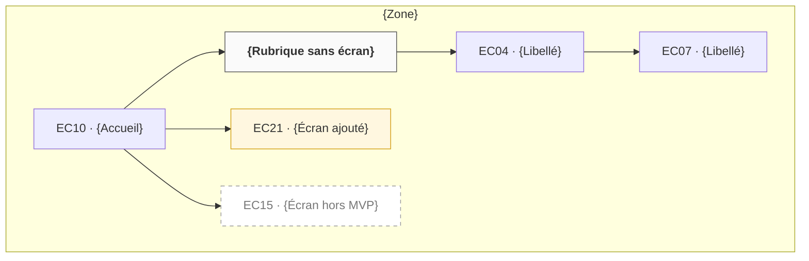

# Arborescence — {nom du projet}

<!-- Un diagramme par zone. Lieux uniquement, chacun une seule fois. Libellés = glossaire. Flèches = parent → enfant. -->
<!-- Nœuds : écrans = ID d'inventaire (EC04) ; rubriques sans écran r1 ; zones z1. Jamais de nœud « end ». -->

## Vue d'ensemble

| Zone | Schéma d'organisation | Justification | Rubriques de 1er niveau | Profondeur max |
|---|---|---|---|---|
| {Espace client} | {par objet} | {constat persona ou flow} | {Mes démarches, Mes contrats, Mes documents} | {2} |

## {Zone}

| Rubrique | Contient | Pourquoi ici |
|---|---|---|
| {Mes démarches} | EC04, EC07 | {objet Demande, tâche la plus fréquente de {Prénom}} |

## Écrans contextuels

<!-- Rappel : rattachés à leur parent, détail dans l'inventaire. -->

| Parent | Contextuels |
|---|---|
| [EC04](./01-contenus.inventory.md#ec04) {libellé} | EC05, EC09 |

## Écarts aux règles
- {rubrique à plus de 7 entrées, lieu à plus de 3 niveaux, tâche Must à plus de 2 niveaux : justification}
