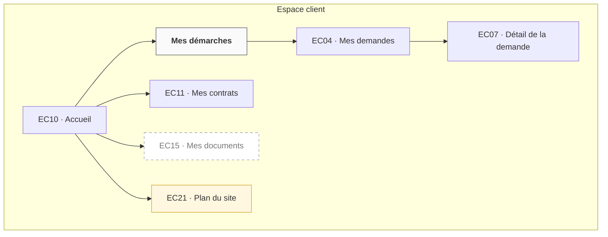

# Exemples commentés — ux-05-information-architecture

> Projet fictif servant de fil rouge à tous les skills : l'**espace client** d'une organisation qui traite des demandes de ses clients. Ces exemples montrent le niveau de détail attendu. Ne jamais recopier leur contenu.

## 1. Inventaire des contenus (extrait)

**Objet métier**

| Objet | Attributs utiles au persona | Relations | Actions | Écrans | Stories |
|---|---|---|---|---|---|
| Demande | objet, date d'envoi, statut, délai estimé, réponse | des pièces jointes, un compte, un contrat | consulter, compléter, annuler | EC04, EC05, EC07 | US-01.01, US-01.02 |

**Écrans**

| ID | Écran | Type | Parent | Zone | Objets et contenus | Actions | Version |
|---|---|---|---|---|---|---|---|
| EC04 | Suivi des demandes | lieu | — | Espace client | Demande : liste, statut, délai | ouvrir une demande, envoyer une demande | MVP |
| EC05 | Envoi d'une demande | contextuel | EC04 | Espace client | Demande : objet ; Pièce jointe | joindre, envoyer, annuler | MVP |
| EC09 | Justificatif illisible | contextuel | EC05 | Espace client | message d'erreur, consignes | reprendre la photo, être rappelé | MVP |

## 2. Lieu ou contextuel ?

| Écran | Type | Pourquoi |
|---|---|---|
| Suivi des demandes | **lieu** | Sophie y revient chaque jour sans refaire la tâche |
| Détail d'une demande | **lieu** | On y arrive par lien profond depuis une notification |
| Confirmation d'envoi | contextuel | N'existe qu'à la fin de l'envoi |
| Justificatif illisible | contextuel | Erreur pendant l'envoi |

## 3. Arborescence (zone Espace client)

## 4. Vérification par flow

| Flow | Point d'entrée | Premier écran | Chemin | Clics | Verdict |
|---|---|---|---|---|---|
| UF-01.01 | Courrier demandant un justificatif | EC05 | EC10 → nav. globale « Mes démarches » → EC04 → « Envoyer une demande » → EC05 | 2 | ✅ |
| UF-01.02 | Notification « demande traitée » | EC07 | Lien profond → connexion → EC07 | 0 | ✅ |
| UF-02.03 | Recherche Google « modifier mon RIB » | EC12 | aucun : la page n'est pas publique et n'a pas de lien depuis le site public | — | ❌ inatteignable → retour vers les flows |

## 5. Libellés

| Élément | Libellé | Termes à éviter | Source | Confiance |
|---|---|---|---|---|
| EC04 | Mes demandes | Requêtes, Tickets, Dossiers en instance | « je regarde où en sont mes demandes » `[P01][P05]` | 🟢 |
| r1 | Mes démarches | Services en ligne, Self-care | « faire mes démarches » `[P03]` | 🟡 |

✅ « Mes demandes » — le mot des personas, 2 mots, sans ambiguïté.

❌ « Gestion des requêtes clients » — vocabulaire interne, 4 mots, point de vue de l'organisation.

## 6. Questions du test d'arborescence

✅ « Vous avez envoyé un dossier la semaine dernière, vous voulez savoir s'il avance. » → réponse attendue : EC04 ou EC07.

❌ « Où trouvez-vous **Mes demandes** ? » — reprend le libellé de l'arbre : le test mesure la correspondance des mots, pas la compréhension.
