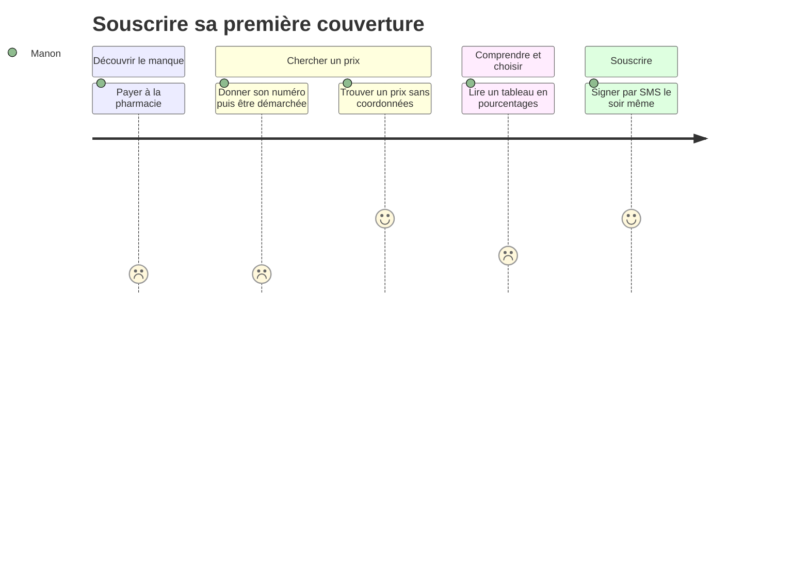
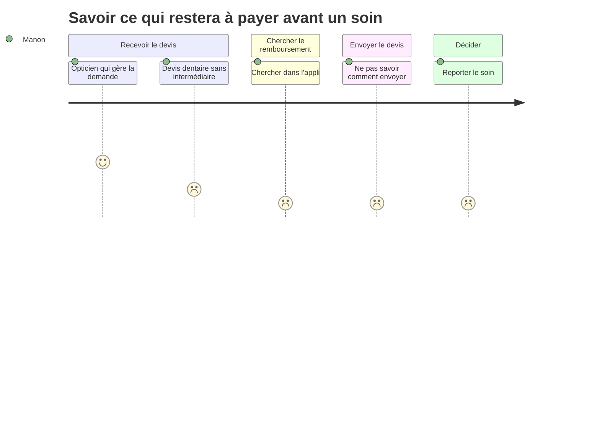

⚠️ Livrable fondé sur des données simulées, sans valeur de recherche.

# Customer journey map — Manon (état actuel)

**Persona** : [Manon](../02-persona/01-manon.persona.md)

## Souscrire sa première couverture

- **Scénario** : Manon découvre qu'elle n'est plus couverte (fin de portabilité, installation à son compte). Elle veut une mutuelle le soir même, sur son téléphone, au prix le plus bas possible.
- **Début / fin** : un incident (payer à la pharmacie, conseil du comptable) → contrat signé et carte reçue
- **Statut des données** : 🟢 fondé — SIM-P01, SIM-P05, SIM-A01, SIM-S01

### Vue d'ensemble

| | Découvrir le manque | Chercher un prix | Comprendre et choisir | Souscrire |
|---|---|---|---|---|
| **Actions** | Paie à la pharmacie ce qu'elle ne payait pas, ou reçoit la liste du comptable `[SIM-P01][SIM-P05]` | Tape « mutuelle pas chère » sur son téléphone ; teste un comparateur, puis les sites d'assureurs connus `[SIM-P01]` | Regarde le prix des formules ; parcourt les étoiles et 2 ou 3 avis `[SIM-P01]` | Signe par code SMS le soir même ; ou garde les options cochées par le courtier `[SIM-P01][SIM-P05]` |
| **Points de contact / canaux** | Pharmacie, mail non lu, expert-comptable `[SIM-P01][SIM-P05]` | Moteur de recherche, comparateur, site d'assureur, mobile `[SIM-P01]` | Tableau de garanties sur mobile `[SIM-P01]` | Formulaire mobile, SMS, lien du courtier `[SIM-P01][SIM-P05]` |
| **Pensées** | « Je savais même pas que ça s'arrêtait. » `[SIM-P01]` | « Tu peux pas voir les prix sans [donner ton numéro]. » `[SIM-P01]` | « 100 % c'est bien, ça veut dire tout remboursé. » `[SIM-P01]` | « Je suis jamais malade. » `[SIM-P05]` |
| **Émotions** (😀 / 😐 / 😟) | 😟 | 😟 | 😐 | 😀 |
| **Points de friction** | Fin de couverture non perçue `[SIM-P01]` | Numéro exigé avant le prix, puis 4 à 5 appels de démarchage `[SIM-P01][SIM-A01]` ; formulaire long, terme « régime » incompris `[SIM-P01]` | Tableau en % illisible sur mobile `[SIM-P01][SIM-A01][SIM-S01]` | Questionnaire rempli en 2 minutes, antécédent omis `[SIM-P05]` |
| **Opportunités** | Alerte de fin de portabilité ⚪ | Tarif sans coordonnées, dès l'âge et le code postal | Exemples en euros par formule (lunettes, couronne, consultation) | Questions de santé illustrées ; récapitulatif « ce qui n'est pas couvert » avant la signature |

### Courbe émotionnelle

### Moments de vérité
- L'affichage du prix : si le site exige un numéro, elle part `[SIM-P01][SIM-A01]`
- Le premier soin coûteux après la souscription, où elle découvre le vrai reste à charge `[SIM-P01][SIM-A01]`

### Priorités d'amélioration
1. Tarif immédiat sans coordonnées : capte les autonomes qui fuient le démarchage
2. Garanties en exemples en euros : évite la déception au premier soin et les résiliations
3. Questions de santé guidées : réduit le risque de fausse déclaration involontaire

### Hypothèses à valider
- La souscription « d'une traite » sur mobile concerne surtout les moins de 35 ans (SIM-S01 : 39 %) ⚪
- Une alerte de fin de portabilité serait reçue par la bonne personne ⚪

## Savoir ce qui restera à payer avant un soin

- **Scénario** : un praticien remet à Manon un devis (couronne, orthodontie de son enfant). Elle veut savoir combien elle paiera avant d'accepter.
- **Début / fin** : devis remis par le praticien → soin accepté ou reporté en connaissant son reste à charge
- **Statut des données** : 🟢 fondé — SIM-P01, SIM-P03, SIM-A02, SIM-S01

### Vue d'ensemble

| | Recevoir le devis | Chercher le remboursement | Envoyer le devis | Décider |
|---|---|---|---|---|
| **Actions** | Le praticien explique, ou l'opticien fait lui-même la demande `[SIM-P01][SIM-P03]` | Ouvre l'appli, ne trouve pas d'estimation `[SIM-P01]` | Garde le devis dans son sac 3 semaines `[SIM-P03]` | Reporte le soin, ou laisse l'opticien gérer `[SIM-P01][SIM-P03]` |
| **Points de contact / canaux** | Cabinet, opticien `[SIM-P01][SIM-P03]` | Appli mobile, tableau de garanties `[SIM-P01]` | Appli (« envoyer un document » ?), courrier `[SIM-P03]` | Praticien `[SIM-P01][SIM-P03]` |
| **Pensées** | « L'opticien il fait ça tous les jours. » `[SIM-P03]` | « Sur l'appli y'a rien pour ça, ou alors j'ai pas trouvé. » `[SIM-P01]` | « Je sais pas comment. Par courrier ? » `[SIM-P03]` | « Donc j'ai repoussé. » `[SIM-P01]` |
| **Émotions** (😀 / 😐 / 😟) | 😐 | 😟 | 😟 | 😟 |
| **Points de friction** | Aucun intermédiaire en orthodontie `[SIM-P03][SIM-A02]` | Montant introuvable en euros `[SIM-P01][SIM-A02]` | Pas d'accès propre (compte du conjoint) ; pas d'accusé de réception `[SIM-P03][SIM-A02]` | Réponse en 12 jours en moyenne `[SIM-S01]` |
| **Opportunités** | Ouvrir l'estimation depuis le devis | Simulateur de reste à charge par type de soin | Dépôt du devis en photo, avec accusé de réception et délai annoncé | Réponse en euros, comparée à l'équipement 100 % Santé |

### Courbe émotionnelle

### Moments de vérité
- Le devis sans intermédiaire (dentaire, orthodontie) : sans réponse simple, le soin est reporté `[SIM-P01][SIM-P03]`

### Priorités d'amélioration
1. Dépôt de devis en photo avec accusé de réception et délai : débloque les soins sans intermédiaire
2. Estimation en euros par type de soin : remplace l'explication du praticien

### Hypothèses à valider
- Elle ferait confiance à une estimation en ligne sans confirmation écrite ⚪
