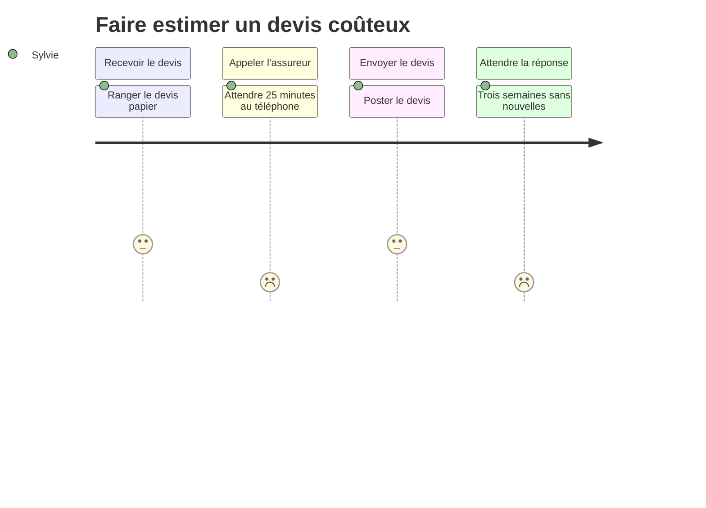
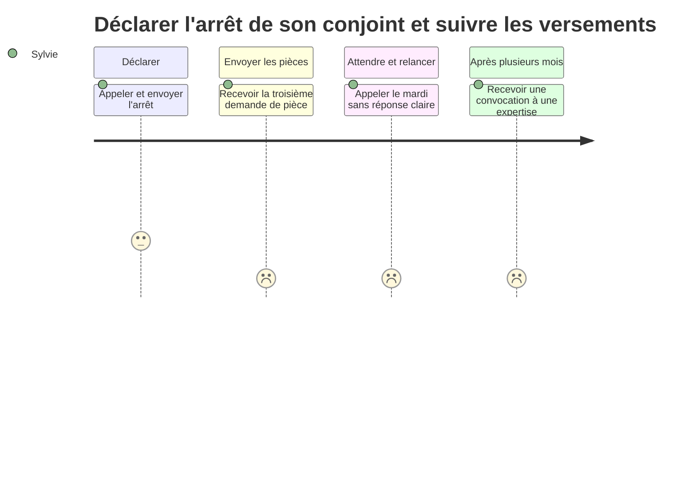

⚠️ Livrable fondé sur des données simulées, sans valeur de recherche.

# Customer journey map — Sylvie (état actuel)

**Persona** : [Sylvie](../02-persona/02-sylvie.persona.md)

## Faire estimer un devis coûteux

- **Scénario** : l'orthodontiste remet un devis de plus de 2 000 € pour un enfant. Sylvie, qui gère les soins sans être titulaire, veut savoir ce que la mutuelle prendra en charge avant de commencer le traitement.
- **Début / fin** : devis remis → reste à charge connu, traitement lancé
- **Statut des données** : 🟢 fondé — SIM-P03, SIM-P04, SIM-A02, SIM-S01

### Vue d'ensemble

| | Recevoir le devis | Appeler l'assureur | Envoyer le devis | Attendre la réponse |
|---|---|---|---|---|
| **Actions** | Range le devis papier `[SIM-P03][SIM-P04]` | Appelle le numéro de la carte, attend 25 minutes `[SIM-P04]` | Envoie par la poste avec une lettre `[SIM-P04]` | Attend un courrier ; l'orthodontiste attend aussi `[SIM-P04][SIM-A02]` |
| **Points de contact / canaux** | Cabinet d'orthodontie `[SIM-P03][SIM-P04]` | Téléphone `[SIM-P04]` | Courrier ; ou appli sans accusé de réception `[SIM-P04][SIM-A02]` | Courrier `[SIM-P04]` |
| **Pensées** | « Envoyez-le à votre mutuelle » (consigne du praticien) `[SIM-P03]` | « Elle pouvait pas me dire comme ça. » `[SIM-P04]` | Ne savait pas qu'on pouvait le déposer en ligne `[SIM-P04]` | « Que quand on envoie un devis, on sache en deux jours. » `[SIM-P04]` |
| **Émotions** (😀 / 😐 / 😟) | 😐 | 😟 | 😐 | 😟 |
| **Points de friction** | Aucun intermédiaire, contrairement à l'optique `[SIM-P03][SIM-S01]` | Attente ; aucune estimation possible au téléphone `[SIM-P04][SIM-A02]` | Pas d'accès propre à l'espace en ligne `[SIM-P03][SIM-P04]` | 3 semaines à 1 mois, devis « non reçu » `[SIM-P04][SIM-A02]` |
| **Opportunités** | Indiquer sur le devis comment l'envoyer ⚪ | Estimation en euros accessible sans appeler | Accès proche délégué ; dépôt sans compte du titulaire | Accusé de réception, délai annoncé, réponse en euros par semestre |

### Courbe émotionnelle

### Moments de vérité
- L'appel où l'assureur ne peut rien dire sans le devis : le canal préféré ne répond pas `[SIM-P04][SIM-A02]`

### Priorités d'amélioration
1. Accès proche délégué : la personne qui gère peut agir sans les codes du titulaire
2. Accusé de réception et délai annoncé pour chaque devis : supprime l'attente aveugle

### Hypothèses à valider
- Le proche gestionnaire accepterait de créer son propre accès en ligne ⚪

## Déclarer l'arrêt de son conjoint et suivre les versements

- **Scénario** : le mari de Sylvie, artisan, est arrêté après une opération. C'est elle qui déclare l'arrêt, envoie les pièces et surveille les indemnités qui doivent payer les charges de l'entreprise.
- **Début / fin** : début de l'arrêt → indemnités versées régulièrement (ou passage en invalidité)
- **Statut des données** : 🟢 fondé — SIM-P07, SIM-A03, SIM-S02 (le proche gestionnaire n'est observé directement que dans SIM-P07 🟡)

### Vue d'ensemble

| | Déclarer | Envoyer les pièces | Attendre et relancer | Après plusieurs mois |
|---|---|---|---|---|
| **Actions** | Appelle l'agent, puis envoie l'arrêt en recommandé, 3 semaines après l'opération `[SIM-P07]` | Envoie chaque pièce réclamée par courrier, une à une `[SIM-P07][SIM-A03]` | Appelle chaque mardi `[SIM-P07]` | Reçoit une convocation à une expertise `[SIM-P07]` |
| **Points de contact / canaux** | Téléphone, courrier, kiné qui alerte `[SIM-P07]` | Courrier, pli « confidentiel médecin-conseil » `[SIM-P07]` | Téléphone ; espace en ligne bloqué `[SIM-P07]` | Courrier `[SIM-P07]` |
| **Pensées** | Ne connaissait pas le délai de déclaration `[SIM-P07]` | « Si on m'avait donné la liste au début... » `[SIM-P07]` | « On savait pas. On sait pas. » `[SIM-P07]` | « Plus d'argent ou moins ? » `[SIM-P07]` |
| **Émotions** (😀 / 😐 / 😟) | 😐 | 😟 | 😟 | 😟 |
| **Points de friction** | Délai inconnu, déclaration tardive `[SIM-P07]` | Pièces au compte-gouttes, une annoncée manquante alors qu'envoyée `[SIM-P07][SIM-A03][SIM-S02]` | Aucune date ni montant ; découvert bancaire ; mot de passe bloqué `[SIM-P07][SIM-A03][SIM-S02]` | Invalidité inexpliquée `[SIM-P07][SIM-A03]` 🟡 |
| **Opportunités** | Délai de déclaration affiché ; déclaration possible par un proche | Liste complète des pièces dès la déclaration, état de chaque pièce | Date et montant prévisionnels du prochain versement | Explication arrêt / invalidité / expertise, rappel par un gestionnaire |

### Courbe émotionnelle

### Moments de vérité
- Le premier versement : sa date conditionne la trésorerie de l'entreprise `[SIM-P07][SIM-S02]`
- La convocation à l'expertise, vécue comme une menace faute d'explication `[SIM-P07][SIM-A03]`

### Priorités d'amélioration
1. Liste complète des pièces dès le départ : dossier complet, 18 jours au lieu de 47 avant le premier versement `[SIM-S02]`
2. Date et montant prévisionnels du versement : supprime le premier motif d'appel
3. Accès proche délégué pour déclarer et suivre à la place de l'assuré

### Hypothèses à valider
- Explications sur l'invalidité et l'expertise attendues en ligne plutôt qu'au téléphone ⚪
