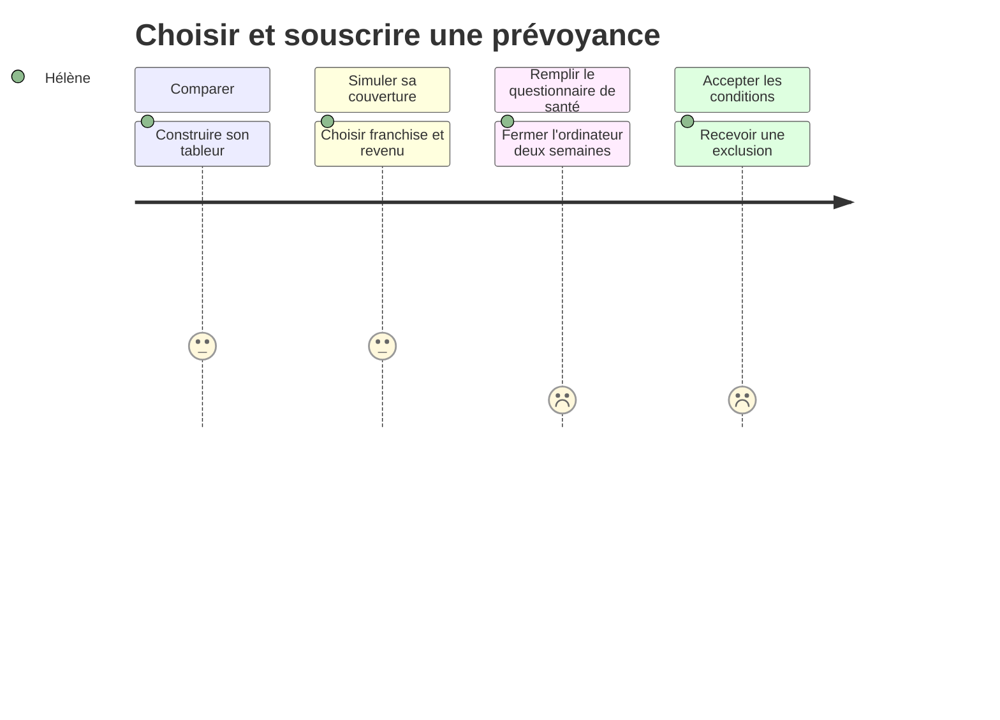
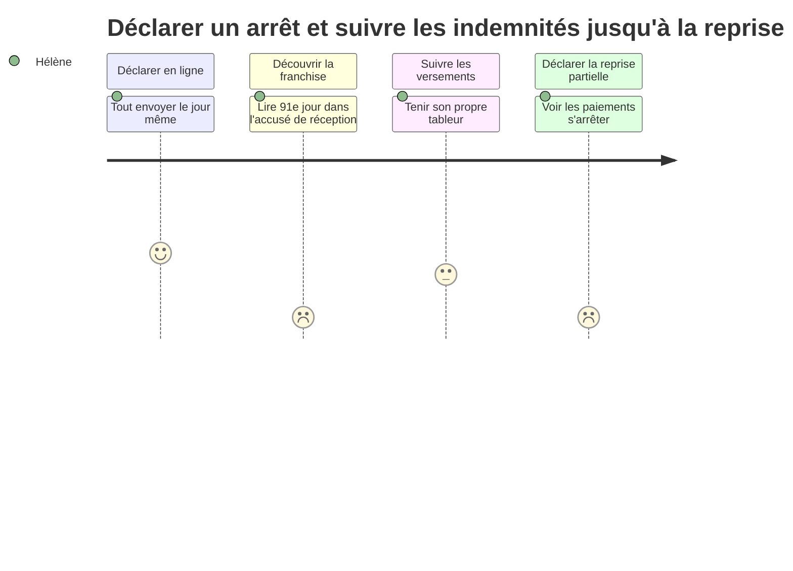

⚠️ Livrable fondé sur des données simulées, sans valeur de recherche.

# Customer journey map — Hélène (état actuel)

**Persona** : [Hélène](../02-persona/03-helene.persona.md)

## Choisir et souscrire une prévoyance

- **Scénario** : installée en libéral, Hélène veut couvrir sa perte de revenus en cas d'arrêt ou d'invalidité. Elle compare seule plusieurs assureurs avant de s'engager.
- **Début / fin** : décision de se couvrir → contrat accepté (avec ou sans exclusion ni surprime)
- **Statut des données** : 🟡 partiel — SIM-P06, SIM-A01, SIM-S02

### Vue d'ensemble

| | Comparer | Simuler sa couverture | Remplir le questionnaire de santé | Accepter les conditions |
|---|---|---|---|---|
| **Actions** | Tableur sur 4 assureurs, élimine ceux qui exigent des coordonnées `[SIM-P06]` | Choisit revenu garanti et franchise de 30 jours `[SIM-P06]` | Ordinateur fermé 2 semaines, puis remplit `[SIM-P06]` | Refuse une exclusion, change d'assureur pour une surprime `[SIM-P06]` |
| **Points de contact / canaux** | Sites d'assureurs, conditions générales, avis sur les délais de paiement `[SIM-P06]` | Formulaire de devis `[SIM-P06]` | Questionnaire en ligne et questionnaire complémentaire `[SIM-P06][SIM-A01]` | Proposition de l'assureur `[SIM-P06][SIM-A01]` |
| **Pensées** | « Je n'aime pas qu'on choisisse pour moi. » `[SIM-P06]` | « Il y a une histoire de plafond. » `[SIM-P06]` | « J'ai envisagé de mentir. Une seconde. » `[SIM-P06]` | « Pour une formatrice, ce n'est pas rien. » `[SIM-P06]` |
| **Émotions** (😀 / 😐 / 😟) | 😐 | 😐 | 😟 | 😟 |
| **Points de friction** | Barème d'invalidité enfoui dans les conditions générales `[SIM-P06]` | Montant net jamais calculé `[SIM-P06][SIM-S02]` | Questions intimes, aucune garantie sur qui lit `[SIM-P06]` | Exclusions connues seulement après le questionnaire `[SIM-P06][SIM-A01]` |
| **Opportunités** | Fiche comparable : franchise, indemnités, barème, exclusions types | Simulateur du montant net (régime obligatoire + assureur) | Mention « lu uniquement par le médecin-conseil » ; sauvegarde et reprise | Exclusions et surprimes possibles annoncées avant le questionnaire |

### Courbe émotionnelle

### Moments de vérité
- Le questionnaire de santé : pause, tentation de mentir, puis changement d'assureur `[SIM-P06][SIM-S02]`

### Priorités d'amélioration
1. Simulateur du montant net : le chiffre que personne n'a `[SIM-P06][SIM-S02]`
2. Transparence avant le questionnaire (exclusions types, accès aux données) : limite les abandons et les fausses déclarations

### Hypothèses à valider
- Le parcours de souscription en ligne seul ne concerne qu'une minorité de TNS (21 % d'après SIM-S02) 🟡

## Déclarer un arrêt et suivre les indemnités jusqu'à la reprise

- **Scénario** : Hélène est arrêtée pour un traitement long, puis reprend à temps partiel thérapeutique. Elle veut être indemnisée sans interruption.
- **Début / fin** : début de l'arrêt → reprise à temps partiel indemnisée
- **Statut des données** : 🟢 fondé — SIM-P08, SIM-A03, SIM-S02

### Vue d'ensemble

| | Déclarer en ligne | Découvrir la franchise | Suivre les versements | Déclarer la reprise partielle |
|---|---|---|---|---|
| **Actions** | Déclare et scanne toutes les pièces le jour même `[SIM-P08]` | Lit « indemnisation à compter du 91e jour » dans l'accusé de réception `[SIM-P08]` | Tient un tableur des versements `[SIM-P08]` | Coche « reprise » faute de choix adapté ; 3 appels, puis un courrier `[SIM-P08]` |
| **Points de contact / canaux** | Espace client, dépôt de pièces `[SIM-P08]` | Courrier, contrat PDF de 40 pages `[SIM-P08]` | Espace client (« paiement effectué ») `[SIM-P08][SIM-A03]` | Formulaire en ligne, téléphone, courrier `[SIM-P08][SIM-A03]` |
| **Pensées** | « Je suis du genre organisé. » `[SIM-P08]` | « Personne ne me l'avait rappelé. » `[SIM-P08]` | Le rythme compris, ça va `[SIM-P08]` | Le temps partiel thérapeutique n'existe pas pour eux `[SIM-P08][SIM-A03]` |
| **Émotions** (😀 / 😐 / 😟) | 😀 | 😟 | 😐 | 😟 |
| **Points de friction** | Doute après coup sur qui lit les pièces médicales `[SIM-P08]` | Franchise oubliée, 3 mois sans revenus `[SIM-P08][SIM-A03][SIM-S02]` | Versements à dates variables, visibles seulement après coup `[SIM-P08][SIM-A03]` | Paiements interrompus ; conseiller qui ne connaît pas le dispositif `[SIM-P08][SIM-A03]` |
| **Opportunités** | Accès aux pièces médicales affiché | Franchise et date de début d'indemnisation annoncées dès la déclaration ; rappel annuel | Calendrier prévisionnel des versements | Choix « temps partiel thérapeutique » avec pièces attendues |

### Courbe émotionnelle

### Moments de vérité
- L'accusé de réception qui révèle la franchise `[SIM-P08][SIM-A03]`
- Le changement de situation (reprise partielle), qui interrompt les paiements `[SIM-P08][SIM-A03]`

### Priorités d'amélioration
1. Franchise et date de début annoncées dès la déclaration, et rappelées chaque année
2. Prise en charge des changements de situation dans le formulaire : évite les interruptions de paiement
3. Calendrier prévisionnel des versements

### Hypothèses à valider
- Les changements de situation (temps partiel, prolongation, invalidité) sont fréquents chez les libéraux ⚪
