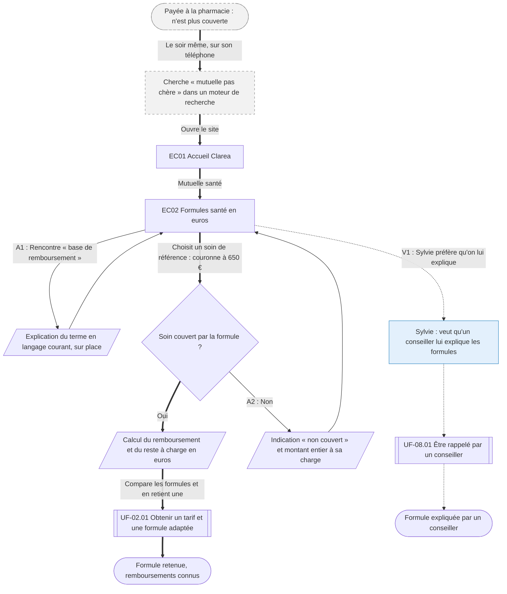

⚠️ Livrable fondé sur des données simulées, sans valeur de recherche.

# UF-01.01 — Comprendre ce que rembourse chaque formule santé avant de choisir

> Épopée : [01 Comprendre et comparer une offre](../../04-user-stories/01-comprendre-et-comparer-une-offre/00-comprendre-et-comparer-une-offre.epic.md) · Persona principal : [Manon](../../02-persona/01-manon.persona.md) · Variantes : [Sylvie](../../02-persona/02-sylvie.persona.md)
> Stories couvertes : [US-01.01](../../04-user-stories/01-comprendre-et-comparer-une-offre/01-savoir-ce-que-rembourse-chaque-formule.story.md)
> Stories mobilisées (autres épopées) : US-02.01 *(renvoi `uf1`)*, US-08.01 *(renvoi `uf2`)*

- **Déclencheur** : Manon découvre à la pharmacie qu'elle n'est plus couverte
- **Fin** : Manon a retenu une formule en sachant ce qu'elle rembourse en euros et passe au tarif
- **Points d'entrée** : moteur de recherche, sur mobile, le soir même — d'après [Souscrire sa première couverture](../../03-customer-journey-map/01-manon.cjm.md#souscrire-sa-première-couverture)
- **Appareil principal** : mobile — d'après « Quand et sur quoi » de la fiche de Manon

## Diagramme

<!-- Happy path : flèches épaisses ==> · alternatives et erreurs : --> · variantes : -.-> -->
<!-- Nœuds : écrans = ID d'inventaire (EC05) ; sinon start, fin, d1, s1, x1, v1, uf1. Jamais « end ». -->

## Chemins

| ID | Type | Quand | Suite de nœuds | Issue |
|---|---|---|---|---|
| `HP` | Happy path | Le soin est couvert, Manon compare les montants | start → x1 → EC01 → EC02 → d1 → s2 → uf1 → fin | Formule retenue, passage au tarif |
| `A1` | Alternatif | Un terme technique bloque la lecture | EC02 → s1 → EC02 | Rejoint le happy path |
| `A2` | Alternatif | La formule ne couvre pas le soin choisi | d1 → s3 → EC02 | Manon compare une autre formule ou un autre soin |
| `V1` | Variante Sylvie | Contact humain indispensable `[SIM-P02][SIM-P07]` | EC02 → v1 → uf2 → fin2 | Explication par un conseiller |

## Étapes du happy path

| # | Écran | Action du persona | Réponse du système | Story |
|---|---|---|---|---|
| 1 | — (moteur de recherche) | Cherche une mutuelle depuis son téléphone | — | — |
| 2 | [EC01](../00-index.md#ec01) Accueil Clarea | Choisit la mutuelle santé | Présente les offres santé et prévoyance | — |
| 3 | [EC02](../00-index.md#ec02) Formules santé en euros | Choisit un soin de référence (couronne à 650 €) | Affiche, par formule, le remboursement, le reste à charge et le prix mensuel | US-01.01 |
| 4 | — (renvoi UF-02.01) | Retient une formule | Ouvre la demande de tarif | US-02.01 |

## Couverture des scénarios

| Story | Scénario | Chemin |
|---|---|---|
| US-01.01 | Reste à charge en euros pour un soin courant | `HP` |
| US-01.01 | Terme technique rencontré | `A1` |
| US-01.01 | Soin non couvert par la formule | `A2` |

## Retours vers le backlog

| Type | Story concernée | Proposition | Statut |
|---|---|---|---|
| — | — | Aucun | — |

## Questions ouvertes
- Quels soins de référence proposer par défaut (consultation, lunettes, couronne, hospitalisation) ?
