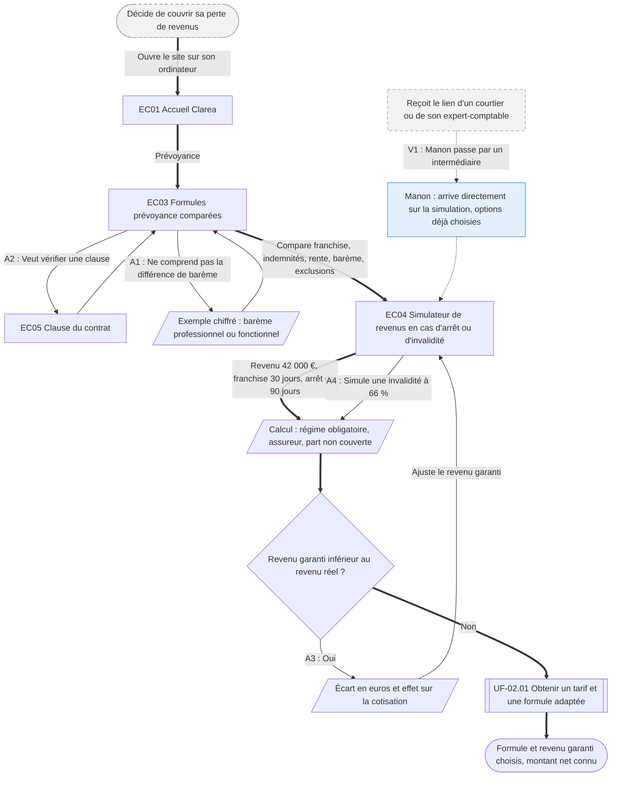

⚠️ Livrable fondé sur des données simulées, sans valeur de recherche.

# UF-01.02 — Choisir une prévoyance en connaissant le montant net

> Épopée : [01 Comprendre et comparer une offre](../../04-user-stories/01-comprendre-et-comparer-une-offre/00-comprendre-et-comparer-une-offre.epic.md) · Persona principal : [Hélène](../../02-persona/03-helene.persona.md) · Variantes : [Manon](../../02-persona/01-manon.persona.md)
> Stories couvertes : [US-01.02](../../04-user-stories/01-comprendre-et-comparer-une-offre/02-comparer-les-garanties-prevoyance.story.md), [US-01.03](../../04-user-stories/01-comprendre-et-comparer-une-offre/03-simuler-ses-indemnites.story.md)
> Stories mobilisées (autres épopées) : US-02.01 *(renvoi `uf1`)*

- **Déclencheur** : installée en libéral, Hélène décide de couvrir sa perte de revenus
- **Fin** : Hélène a retenu une formule et un revenu garanti en connaissant ce qu'elle toucherait, et passe au tarif
- **Points d'entrée** : site de l'assureur, sur ordinateur, le soir, en plusieurs fois ; lien envoyé par un courtier pour la variante — d'après [Choisir et souscrire une prévoyance](../../03-customer-journey-map/03-helene.cjm.md#choisir-et-souscrire-une-prévoyance)
- **Appareil principal** : ordinateur — d'après « Quand et sur quoi » de la fiche d'Hélène

## Diagramme

<!-- Happy path : flèches épaisses ==> · alternatives et erreurs : --> · variantes : -.-> -->
<!-- Nœuds : écrans = ID d'inventaire (EC05) ; sinon start, fin, d1, s1, x1, v1, uf1. Jamais « end ». -->

## Chemins

| ID | Type | Quand | Suite de nœuds | Issue |
|---|---|---|---|---|
| `HP` | Happy path | Hélène compare, simule un arrêt, son revenu garanti est juste | start → EC01 → EC03 → EC04 → s2 → d1 → uf1 → fin | Formule choisie, passage au tarif |
| `A1` | Alternatif | Barème incompris | EC03 → s1 → EC03 | Rejoint le happy path |
| `A2` | Alternatif | Hélène veut lire la clause exacte | EC03 → EC05 → EC03 | Rejoint le happy path |
| `A3` | Alternatif | Le revenu garanti est sous-évalué | d1 → s3 → EC04 | Nouvelle simulation |
| `A4` | Alternatif | Simulation d'une invalidité plutôt que d'un arrêt | EC04 → s2 | Rejoint le happy path |
| `V1` | Variante Manon | S'appuie sur un courtier `[SIM-P05]` | x1 → v1 → EC04 | Rejoint le happy path à la simulation |

## Étapes du happy path

| # | Écran | Action du persona | Réponse du système | Story |
|---|---|---|---|---|
| 1 | [EC01](../00-index.md#ec01) Accueil Clarea | Choisit la prévoyance | Présente les offres | — |
| 2 | [EC03](../00-index.md#ec03) Formules prévoyance comparées | Compare deux formules | Affiche franchise, indemnités journalières, rente, barème et exclusions fréquentes | US-01.02 |
| 3 | [EC04](../00-index.md#ec04) Simulateur de revenus | Saisit revenu, statut, franchise, durée d'arrêt | Affiche régime obligatoire, part assureur, part non couverte, et rappelle les jours de franchise | US-01.03 |
| 4 | — (renvoi UF-02.01) | Retient la formule | Ouvre la demande de tarif | US-02.01 |

## Couverture des scénarios

| Story | Scénario | Chemin |
|---|---|---|
| US-01.02 | Paramètres clés de chaque formule | `HP` |
| US-01.02 | Barème expliqué par un exemple | `A1` |
| US-01.02 | Document de référence | `A2` |
| US-01.03 | Simulation d'un arrêt de travail | `HP` |
| US-01.03 | Effet d'un revenu garanti sous-évalué | `A3` |
| US-01.03 | Simulation d'une invalidité | `A4` |
| US-01.03 | Arrivée par le lien d'un intermédiaire | `V1` |

## Retours vers le backlog

| Type | Story concernée | Proposition | Statut |
|---|---|---|---|
| scénario manquant | US-01.03 | `V1` : « Étant donné que Manon arrive par le lien d'un courtier avec des options déjà choisies, Quand elle ouvre la simulation, Alors elle voit ce qu'elle toucherait avec ces options, en euros » | accepté |

## Questions ouvertes
- Le lien d'un intermédiaire doit-il préremplir la simulation (revenu, franchise) ?
