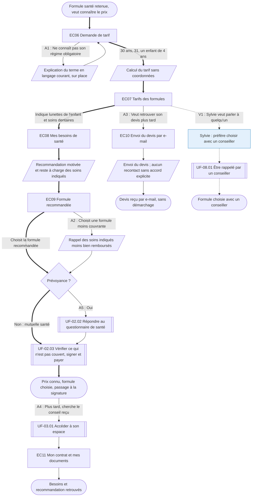

⚠️ Livrable fondé sur des données simulées, sans valeur de recherche.

# UF-02.01 — Obtenir un tarif et une formule adaptée sans laisser ses coordonnées

> Épopée : [02 Souscrire une couverture](../../04-user-stories/02-souscrire-une-couverture/00-souscrire-une-couverture.epic.md) · Persona principal : [Manon](../../02-persona/01-manon.persona.md) · Variantes : [Sylvie](../../02-persona/02-sylvie.persona.md)
> Stories couvertes : [US-02.01](../../04-user-stories/02-souscrire-une-couverture/01-obtenir-un-tarif-sans-coordonnees.story.md), [US-02.02](../../04-user-stories/02-souscrire-une-couverture/02-exprimer-ses-besoins.story.md)
> Stories mobilisées (autres épopées) : US-03.01 *(renvoi `uf3`)*, US-08.01 *(renvoi `uf4`)*

- **Déclencheur** : Manon a retenu une formule (UF-01.01) et veut savoir combien elle paiera
- **Fin** : Manon connaît son prix et la formule adaptée à ses besoins, et passe à la signature
- **Points d'entrée** : suite de UF-01.01 ; e-mail du devis pour un retour ultérieur — d'après [Souscrire sa première couverture](../../03-customer-journey-map/01-manon.cjm.md#souscrire-sa-première-couverture)
- **Appareil principal** : mobile — d'après « Quand et sur quoi » de la fiche de Manon

## Diagramme

<!-- Happy path : flèches épaisses ==> · alternatives et erreurs : --> · variantes : -.-> -->
<!-- Nœuds : écrans = ID d'inventaire (EC05) ; sinon start, fin, d1, s1, x1, v1, uf1. Jamais « end ». -->

## Chemins

| ID | Type | Quand | Suite de nœuds | Issue |
|---|---|---|---|---|
| `HP` | Happy path | Manon obtient un tarif, exprime ses besoins et suit la recommandation | start → EC06 → s2 → EC07 → EC08 → s3 → EC09 → d1 → uf1 → fin | Passage à la signature |
| `A1` | Alternatif | Une information demandée est incomprise | EC06 → s1 → EC06 | Rejoint le happy path |
| `A2` | Alternatif | Manon choisit une formule moins couvrante | EC09 → s4 → d1 | Rejoint le happy path |
| `A3` | Alternatif | Manon veut garder son devis | EC07 → EC10 → s5 → fin2 | Devis reçu, pas de démarchage |
| `A4` | Alternatif | Après la souscription, Manon veut retrouver le conseil | fin → uf3 → EC11 → fin3 | Trace du conseil retrouvée |
| `A5` | Alternatif | La formule est une prévoyance | d1 → uf2 → uf1 | Questionnaire de santé, puis signature (couvert par UF-02.02) |
| `V1` | Variante Sylvie | Contact humain indispensable `[SIM-P02][SIM-P04]` | EC07 → v1 → uf4 → fin4 | Choix avec un conseiller |

## Étapes du happy path

| # | Écran | Action du persona | Réponse du système | Story |
|---|---|---|---|---|
| 1 | [EC06](../00-index.md#ec06) Demande de tarif | Indique âge, code postal, bénéficiaires | Ne demande ni e-mail ni téléphone | US-02.01 |
| 2 | [EC07](../00-index.md#ec07) Tarifs des formules | Consulte les prix mensuels | Affiche le prix de chaque formule | US-02.01 |
| 3 | [EC08](../00-index.md#ec08) Mes besoins de santé | Indique les soins qui comptent pour son foyer | Calcule une recommandation | US-02.02 |
| 4 | [EC09](../00-index.md#ec09) Formule recommandée | Choisit la formule | Affiche la raison de la recommandation et le reste à charge estimé | US-02.02 |
| 5 | — (renvoi UF-02.03) | Passe à la signature | — | — |

## Couverture des scénarios

| Story | Scénario | Chemin |
|---|---|---|
| US-02.01 | Tarif obtenu sans coordonnées | `HP` |
| US-02.01 | Terme inconnu dans les informations demandées | `A1` |
| US-02.01 | Enregistrer son devis sans être rappelée | `A3` |
| US-02.02 | Recommandation à partir des besoins | `HP` |
| US-02.02 | Choix d'une formule différente de la recommandation | `A2` |
| US-02.02 | Trace du conseil | `A4` |

## Retours vers le backlog

| Type | Story concernée | Proposition | Statut |
|---|---|---|---|
| — | — | Aucun (`A5` est un aiguillage dont les scénarios sont couverts par UF-02.02) | — |

## Questions ouvertes
- Faut-il proposer les questions de besoins avant le tarif plutôt qu'après ? À tester (risque d'abandon pour Manon).
