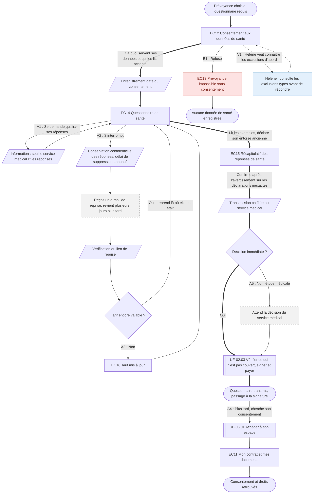

⚠️ Livrable fondé sur des données simulées, sans valeur de recherche.

# UF-02.02 — Répondre au questionnaire de santé de la prévoyance

> Épopée : [02 Souscrire une couverture](../../04-user-stories/02-souscrire-une-couverture/00-souscrire-une-couverture.epic.md) · Persona principal : [Manon](../../02-persona/01-manon.persona.md) · Variantes : [Hélène](../../02-persona/03-helene.persona.md)
> Stories couvertes : [US-02.03](../../04-user-stories/02-souscrire-une-couverture/03-repondre-au-questionnaire-de-sante.story.md), [US-02.04](../../04-user-stories/02-souscrire-une-couverture/04-reprendre-le-questionnaire-de-sante.story.md), [US-02.06](../../04-user-stories/02-souscrire-une-couverture/06-consentir-aux-donnees-de-sante.story.md)
> Stories mobilisées (autres épopées) : US-03.01 *(renvoi `uf2`)*

- **Déclencheur** : Manon a choisi une prévoyance (UF-02.01) ; le questionnaire de santé est requis
- **Fin** : questionnaire transmis au service médical, sans omission, puis passage à la signature
- **Points d'entrée** : suite de UF-02.01 ; e-mail de reprise après interruption (le futur client n'a pas encore d'espace adhérent) — d'après [Souscrire sa première couverture](../../03-customer-journey-map/01-manon.cjm.md#souscrire-sa-première-couverture) et [Choisir et souscrire une prévoyance](../../03-customer-journey-map/03-helene.cjm.md#choisir-et-souscrire-une-prévoyance)
- **Appareil principal** : mobile pour Manon, ordinateur pour Hélène

## Diagramme

<!-- Happy path : flèches épaisses ==> · alternatives et erreurs : --> · variantes : -.-> -->
<!-- Nœuds : écrans = ID d'inventaire (EC05) ; sinon start, fin, d1, s1, x1, v1, uf1. Jamais « end ». -->

## Chemins

| ID | Type | Quand | Suite de nœuds | Issue |
|---|---|---|---|---|
| `HP` | Happy path | Manon consent, répond en une fois, décision immédiate | start → EC12 → s1 → EC14 → EC15 → s2 → d2 → uf1 → fin | Passage à la signature |
| `E1` | Erreur | Manon refuse le consentement | EC12 → EC13 → fin2 | Aucune donnée enregistrée ; elle peut revenir plus tard |
| `A1` | Alternatif | Inquiétude sur qui lit les réponses | EC14 → s3 → EC14 | Rejoint le happy path |
| `A2` | Alternatif | Interruption puis reprise, tarif encore valable | EC14 → s4 → x1 → s5 → d1 → EC14 | Reprise à la question suivante, par le lien reçu par e-mail |
| `A3` | Alternatif | Reprise avec un tarif expiré | d1 → EC16 → EC14 | Nouveau tarif connu avant de continuer |
| `A4` | Alternatif | Après la souscription, recherche du consentement donné | fin → uf2 → EC11 → fin3 | Consentement retrouvé |
| `A5` | Alternatif | Les réponses nécessitent une étude médicale | d2 → x2 → uf1 | Signature après la décision |
| `V1` | Variante Hélène | Veut les exclusions avant le questionnaire `[SIM-P06]` | EC12 → v1 → EC12 | Rejoint le happy path |

## Étapes du happy path

| # | Écran | Action du persona | Réponse du système | Story |
|---|---|---|---|---|
| 1 | [EC12](../00-index.md#ec12) Consentement aux données de santé | Lit et accepte | Enregistre le consentement daté | US-02.06 |
| 2 | [EC14](../00-index.md#ec14) Questionnaire de santé | Répond, aidée par les exemples (même ancien, même guéri) | Indique la période visée par chaque question | US-02.03 |
| 3 | [EC15](../00-index.md#ec15) Récapitulatif des réponses de santé | Relit et confirme | Informe des conséquences d'une déclaration inexacte, transmet au service médical | US-02.03 |
| 4 | — (renvoi UF-02.03) | Passe à la signature | — | — |

## Couverture des scénarios

| Story | Scénario | Chemin |
|---|---|---|
| US-02.03 | Question illustrée par des exemples | `HP` |
| US-02.03 | Récapitulatif avant validation | `HP` |
| US-02.03 | Qui lit les réponses | `A1` |
| US-02.03 | Réponses nécessitant une étude médicale | `A5` |
| US-02.04 | Reprise après une interruption | `A2` |
| US-02.04 | Tarif expiré pendant l'interruption | `A3` |
| US-02.04 | Réponses conservées de façon confidentielle | `A2` |
| US-02.06 | Consentement éclairé | `HP` |
| US-02.06 | Refus du consentement | `E1` |
| US-02.06 | Retrouver son consentement | `A4` |

## Retours vers le backlog

| Type | Story concernée | Proposition | Statut |
|---|---|---|---|
| scénario manquant | US-02.03 | `A5` : « Étant donné que les réponses de Manon nécessitent une étude par le service médical, Quand elle valide le questionnaire, Alors elle connaît le délai de décision, Et elle est prévenue dès que la proposition est prête » | accepté |
| renvoi à revoir (architecture, R1) | — | `A2` : reprise par un lien envoyé par e-mail au lieu de la connexion, le futur client n'ayant pas d'espace adhérent ; `uf2` conservé pour `A4` | accepté, appliqué |

## Questions ouvertes
- Quel délai de conservation pour un questionnaire interrompu ?
