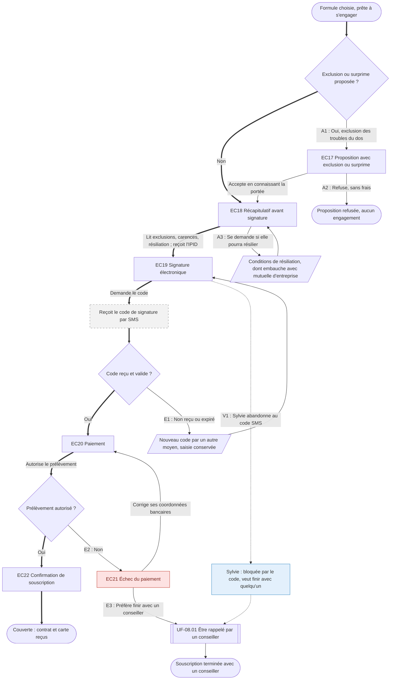

⚠️ Livrable fondé sur des données simulées, sans valeur de recherche.

# UF-02.03 — Vérifier ce qui n'est pas couvert, signer et payer

> Épopée : [02 Souscrire une couverture](../../04-user-stories/02-souscrire-une-couverture/00-souscrire-une-couverture.epic.md) · Persona principal : [Manon](../../02-persona/01-manon.persona.md) · Variantes : [Sylvie](../../02-persona/02-sylvie.persona.md)
> Stories couvertes : [US-02.05](../../04-user-stories/02-souscrire-une-couverture/05-connaitre-les-exclusions-avant-de-signer.story.md), [US-02.07](../../04-user-stories/02-souscrire-une-couverture/07-signer-et-payer-en-ligne.story.md)
> Stories mobilisées (autres épopées) : US-08.01 *(renvoi `uf1`)*

- **Déclencheur** : formule choisie (UF-02.01) et, pour une prévoyance, questionnaire transmis (UF-02.02)
- **Fin** : Manon est couverte, avec contrat et carte de tiers payant
- **Points d'entrée** : suite de UF-02.01 ou UF-02.02 ; SMS de signature (hors application) — d'après [Souscrire sa première couverture](../../03-customer-journey-map/01-manon.cjm.md#souscrire-sa-première-couverture)
- **Appareil principal** : mobile — d'après « Quand et sur quoi » de la fiche de Manon

## Diagramme

<!-- Happy path : flèches épaisses ==> · alternatives et erreurs : --> · variantes : -.-> -->
<!-- Nœuds : écrans = ID d'inventaire (EC05) ; sinon start, fin, d1, s1, x1, v1, uf1. Jamais « end ». -->

## Chemins

| ID | Type | Quand | Suite de nœuds | Issue |
|---|---|---|---|---|
| `HP` | Happy path | Pas d'exclusion, code reçu, prélèvement autorisé | start → d1 → EC18 → EC19 → x1 → d2 → EC20 → d3 → EC22 → fin | Couverte le soir même |
| `A1` | Alternatif | Le questionnaire entraîne une exclusion ou une surprime, acceptée | d1 → EC17 → EC18 | Rejoint le happy path |
| `A2` | Alternatif | Manon refuse la proposition | d1 → EC17 → fin2 | Aucun engagement, sans frais |
| `A3` | Alternatif | Question sur la résiliation | EC18 → s1 → EC18 | Rejoint le happy path |
| `E1` | Erreur | Code non reçu ou expiré | d2 → s2 → EC19 | Nouveau code par un autre moyen |
| `E2` | Erreur | Prélèvement refusé, Manon corrige | d3 → EC21 → EC20 | Rejoint le happy path |
| `E3` | Erreur | Prélèvement refusé, Manon préfère de l'aide | d3 → EC21 → uf1 → fin3 | Contact humain |
| `V1` | Variante Sylvie | Abandonne au premier blocage `[SIM-P02][SIM-P07]` | EC19 → v1 → uf1 → fin3 | Contact humain |

## Étapes du happy path

| # | Écran | Action du persona | Réponse du système | Story |
|---|---|---|---|---|
| 1 | [EC18](../00-index.md#ec18) Récapitulatif avant signature | Lit ce qui n'est pas couvert, les carences, la date de résiliation possible | Remet l'IPID | US-02.05 |
| 2 | [EC19](../00-index.md#ec19) Signature électronique | Demande puis saisit le code | Vérifie le code | US-02.07 |
| 3 | [EC20](../00-index.md#ec20) Paiement | Autorise le prélèvement | Vérifie l'autorisation | US-02.07 |
| 4 | [EC22](../00-index.md#ec22) Confirmation de souscription | — | Indique la date de début de couverture, envoie contrat et carte | US-02.07 |

## Couverture des scénarios

| Story | Scénario | Chemin |
|---|---|---|
| US-02.05 | Récapitulatif avant signature | `HP` |
| US-02.05 | Exclusion ou surprime après le questionnaire de santé | `A1`, `A2` |
| US-02.05 | Inquiétude sur la résiliation | `A3` |
| US-02.07 | Souscription terminée | `HP` |
| US-02.07 | Code de signature non reçu ou expiré | `E1` |
| US-02.07 | Échec du paiement | `E2`, `E3` |

## Retours vers le backlog

| Type | Story concernée | Proposition | Statut |
|---|---|---|---|
| — | — | Aucun | — |

## Questions ouvertes
- Moyen alternatif de réception du code (e-mail, appel vocal) à choisir.
