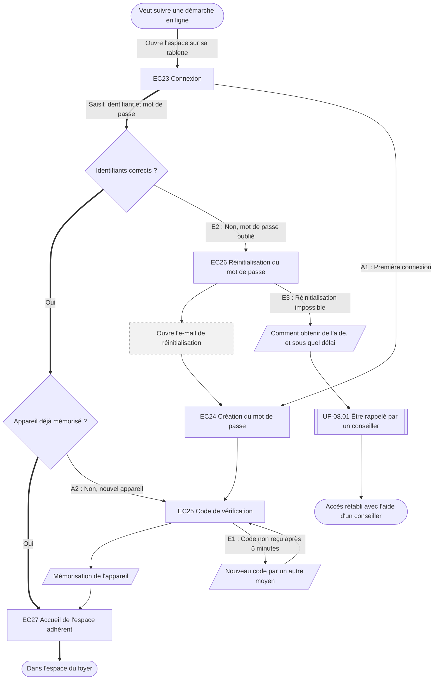

⚠️ Livrable fondé sur des données simulées, sans valeur de recherche.

# UF-03.01 — Accéder à son espace

> Épopée : [03 Accéder à son espace](../../04-user-stories/03-acceder-a-son-espace/00-acceder-a-son-espace.epic.md) · Persona principal : [Sylvie](../../02-persona/02-sylvie.persona.md) · Variantes : —
> Stories couvertes : [US-03.01](../../04-user-stories/03-acceder-a-son-espace/01-acceder-a-son-espace-sans-blocage.story.md)
> Stories mobilisées (autres épopées) : US-08.01 *(renvoi `uf1`)*

- **Déclencheur** : Sylvie veut suivre ou faire une démarche en ligne (devis, arrêt, remboursement)
- **Fin** : Sylvie est dans l'espace du foyer
- **Points d'entrée** : favori du navigateur, lien d'un e-mail de l'assureur, e-mail de réinitialisation — d'après [Déclarer l'arrêt de son conjoint et suivre les versements](../../03-customer-journey-map/02-sylvie.cjm.md#déclarer-larrêt-de-son-conjoint-et-suivre-les-versements) (espace bloqué au changement de mot de passe)
- **Appareil principal** : tablette ou ordinateur fixe — d'après « Quand et sur quoi » de la fiche de Sylvie

## Diagramme

<!-- Happy path : flèches épaisses ==> · alternatives et erreurs : --> · variantes : -.-> -->
<!-- Nœuds : écrans = ID d'inventaire (EC05) ; sinon start, fin, d1, s1, x1, v1, uf1. Jamais « end ». -->

## Chemins

| ID | Type | Quand | Suite de nœuds | Issue |
|---|---|---|---|---|
| `HP` | Happy path | Connexion habituelle sur un appareil mémorisé | start → EC23 → d1 → d2 → EC27 → fin | Dans l'espace, sans code |
| `A1` | Alternatif | Première connexion | EC23 → EC24 → EC25 → s1 → EC27 | Appareil mémorisé, rejoint le happy path |
| `A2` | Alternatif | Connexion depuis un nouvel appareil | d2 → EC25 → s1 → EC27 | Rejoint le happy path |
| `E1` | Erreur | Le code n'arrive pas | EC25 → s2 → EC25 | Nouveau code par un autre moyen |
| `E2` | Erreur | Mot de passe oublié ou bloqué | d1 → EC26 → x1 → EC24 → EC25 → s1 → EC27 | Accès retrouvé sans appeler |
| `E3` | Erreur | La réinitialisation échoue | EC26 → s3 → uf1 → fin2 | Contact humain, délai connu |

## Étapes du happy path

| # | Écran | Action du persona | Réponse du système | Story |
|---|---|---|---|---|
| 1 | [EC23](../00-index.md#ec23) Connexion | Saisit identifiant et mot de passe | Reconnaît l'appareil mémorisé, ne demande pas de code | US-03.01 |
| 2 | [EC27](../00-index.md#ec27) Accueil de l'espace adhérent | Choisit sa démarche | Affiche les démarches en cours du foyer | US-03.01 |

## Couverture des scénarios

| Story | Scénario | Chemin |
|---|---|---|
| US-03.01 | Première connexion | `A1`, `HP` (connexions suivantes sans code) |
| US-03.01 | Mot de passe oublié ou bloqué | `E2`, `E3` |
| US-03.01 | Code de vérification non reçu | `E1` |
| US-03.01 | Connexion depuis un nouvel appareil | `A2` |

## Retours vers le backlog

| Type | Story concernée | Proposition | Statut |
|---|---|---|---|
| scénario manquant | US-03.01 | `A2` : « Étant donné que Sylvie se connecte depuis un appareil qu'elle n'a jamais utilisé, Quand ses identifiants sont corrects, Alors un code de vérification lui est demandé une seule fois, Et l'appareil est mémorisé si elle le souhaite » | accepté |

## Questions ouvertes
- Durée de mémorisation d'un appareil compatible avec la sensibilité des données de santé.
