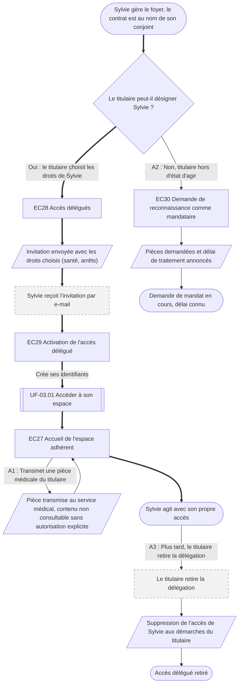

⚠️ Livrable fondé sur des données simulées, sans valeur de recherche.

# UF-03.02 — Obtenir et utiliser un accès délégué pour le foyer

> Épopée : [03 Accéder à son espace](../../04-user-stories/03-acceder-a-son-espace/00-acceder-a-son-espace.epic.md) · Persona principal : [Sylvie](../../02-persona/02-sylvie.persona.md) · Variantes : —
> Stories couvertes : [US-03.02](../../04-user-stories/03-acceder-a-son-espace/02-agir-pour-le-foyer-avec-son-acces.story.md) *(V2)*
> Stories mobilisées (autres épopées) : US-03.01 *(renvoi `uf1`)*

- **Déclencheur** : Sylvie gère les démarches du foyer mais le contrat est au nom de son conjoint
- **Fin** : Sylvie agit avec son propre accès, ses actions tracées à son nom
- **Points d'entrée** : invitation par e-mail envoyée par le titulaire ; demande de mandat quand le titulaire ne peut pas agir — d'après [Faire estimer un devis coûteux](../../03-customer-journey-map/02-sylvie.cjm.md#faire-estimer-un-devis-coûteux) et [Déclarer l'arrêt de son conjoint](../../03-customer-journey-map/02-sylvie.cjm.md#déclarer-larrêt-de-son-conjoint-et-suivre-les-versements)
- **Appareil principal** : tablette ou ordinateur fixe

## Diagramme

<!-- Happy path : flèches épaisses ==> · alternatives et erreurs : --> · variantes : -.-> -->
<!-- Nœuds : écrans = ID d'inventaire (EC05) ; sinon start, fin, d1, s1, x1, v1, uf1. Jamais « end ». -->

## Chemins

| ID | Type | Quand | Suite de nœuds | Issue |
|---|---|---|---|---|
| `HP` | Happy path | Le titulaire désigne Sylvie | start → d1 → EC28 → s1 → x1 → EC29 → uf1 → EC27 → fin | Accès propre, actions tracées |
| `A1` | Alternatif | Sylvie transmet une pièce médicale | EC27 → s2 → EC27 | Pièce au service médical, contenu protégé |
| `A2` | Alternatif | Le titulaire ne peut pas désigner Sylvie | d1 → EC30 → s3 → fin2 | Demande de mandat, délai connu |
| `A3` | Alternatif | Retrait de la délégation | fin → x2 → s4 → fin3 | Accès supprimé |

## Étapes du happy path

| # | Écran | Action du persona | Réponse du système | Story |
|---|---|---|---|---|
| 1 | [EC28](../00-index.md#ec28) Accès délégués | Le titulaire désigne Sylvie et choisit ses droits | Envoie l'invitation | US-03.02 |
| 2 | [EC29](../00-index.md#ec29) Activation de l'accès délégué | Sylvie accepte et crée ses identifiants | Active l'accès avec les droits choisis | US-03.02 |
| 3 | [EC27](../00-index.md#ec27) Accueil de l'espace adhérent | Sylvie fait ses démarches | Enregistre chaque action à son nom | US-03.02 |

## Couverture des scénarios

| Story | Scénario | Chemin |
|---|---|---|
| US-03.02 | Délégation accordée par le titulaire | `HP` |
| US-03.02 | Pièces médicales du titulaire | `A1` |
| US-03.02 | Titulaire dans l'incapacité d'agir | `A2` |
| US-03.02 | Retrait de la délégation | `A3` |

## Retours vers le backlog

| Type | Story concernée | Proposition | Statut |
|---|---|---|---|
| — | — | Aucun | — |

## Questions ouvertes
- Durée de validité de l'invitation, et que faire si elle expire ?
