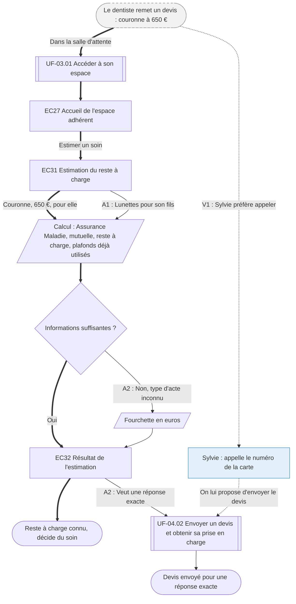

⚠️ Livrable fondé sur des données simulées, sans valeur de recherche.

# UF-04.01 — Estimer ce qui restera à payer avant un soin

> Épopée : [04 Connaître son reste à charge avant un soin](../../04-user-stories/04-connaitre-son-reste-a-charge/00-connaitre-son-reste-a-charge.epic.md) · Persona principal : [Manon](../../02-persona/01-manon.persona.md) · Variantes : [Sylvie](../../02-persona/02-sylvie.persona.md)
> Stories couvertes : [US-04.01](../../04-user-stories/04-connaitre-son-reste-a-charge/01-estimer-son-reste-a-charge.story.md)
> Stories mobilisées (autres épopées) : US-03.01 *(renvoi `uf1`)*

- **Déclencheur** : le dentiste remet à Manon un devis pour une couronne
- **Fin** : Manon connaît son reste à charge et décide du soin
- **Points d'entrée** : devis papier, dans la salle d'attente, sur mobile — d'après [Savoir ce qui restera à payer avant un soin](../../03-customer-journey-map/01-manon.cjm.md#savoir-ce-qui-restera-à-payer-avant-un-soin)
- **Appareil principal** : mobile — d'après « Quand et sur quoi » de la fiche de Manon

## Diagramme

<!-- Happy path : flèches épaisses ==> · alternatives et erreurs : --> · variantes : -.-> -->
<!-- Nœuds : écrans = ID d'inventaire (EC05) ; sinon start, fin, d1, s1, x1, v1, uf1. Jamais « end ». -->

## Chemins

| ID | Type | Quand | Suite de nœuds | Issue |
|---|---|---|---|---|
| `HP` | Happy path | Manon connaît le montant et le type de soin | start → uf1 → EC27 → EC31 → s1 → d1 → EC32 → fin | Reste à charge connu |
| `A1` | Alternatif | Le soin concerne un enfant bénéficiaire | EC31 → s1 | Rejoint le happy path, plafonds de l'enfant pris en compte |
| `A2` | Alternatif | Type d'acte inconnu | d1 → s2 → EC32 → uf2 → fin2 | Fourchette, puis envoi du devis |
| `V1` | Variante Sylvie | Premier réflexe : le téléphone `[SIM-P04]` | start → v1 → uf2 | Envoi du devis |

## Étapes du happy path

| # | Écran | Action du persona | Réponse du système | Story |
|---|---|---|---|---|
| 1 | — (renvoi UF-03.01) | Se connecte depuis son téléphone | — | US-03.01 |
| 2 | [EC27](../00-index.md#ec27) Accueil de l'espace adhérent | Choisit d'estimer un soin | — | US-04.01 |
| 3 | [EC31](../00-index.md#ec31) Estimation du reste à charge | Indique le soin, le montant et le bénéficiaire | Calcule avec les plafonds déjà utilisés | US-04.01 |
| 4 | [EC32](../00-index.md#ec32) Résultat de l'estimation | Lit la répartition en euros | Précise que c'est une estimation | US-04.01 |

## Couverture des scénarios

| Story | Scénario | Chemin |
|---|---|---|
| US-04.01 | Estimation pour une couronne dentaire | `HP` |
| US-04.01 | Soin pour un enfant du foyer | `A1` |
| US-04.01 | Informations insuffisantes pour estimer | `A2` |

## Retours vers le backlog

| Type | Story concernée | Proposition | Statut |
|---|---|---|---|
| — | — | Aucun | — |

## Questions ouvertes
- L'estimation doit-elle être accessible sans connexion, à partir de la formule seule ? Les plafonds déjà utilisés ne seraient alors pas pris en compte.
