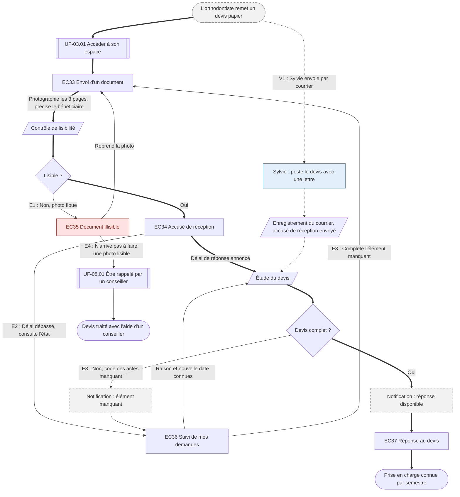

⚠️ Livrable fondé sur des données simulées, sans valeur de recherche.

# UF-04.02 — Envoyer un devis et obtenir sa prise en charge en euros

> Épopée : [04 Connaître son reste à charge avant un soin](../../04-user-stories/04-connaitre-son-reste-a-charge/00-connaitre-son-reste-a-charge.epic.md) · Persona principal : [Manon](../../02-persona/01-manon.persona.md) · Variantes : [Sylvie](../../02-persona/02-sylvie.persona.md)
> Stories couvertes : [US-04.02](../../04-user-stories/04-connaitre-son-reste-a-charge/02-envoyer-un-devis.story.md), [US-04.03](../../04-user-stories/04-connaitre-son-reste-a-charge/03-recevoir-la-reponse-a-un-devis.story.md)
> Stories mobilisées (autres épopées) : US-03.01 *(renvoi `uf1`)*, US-08.01 *(renvoi `uf2`)*

- **Déclencheur** : l'orthodontiste remet un devis papier de 2 400 € sur 3 semestres
- **Fin** : la prise en charge est connue en euros, semestre par semestre
- **Points d'entrée** : devis papier ; notification « réponse disponible » ; envoi postal pour la variante — d'après [Savoir ce qui restera à payer avant un soin](../../03-customer-journey-map/01-manon.cjm.md#savoir-ce-qui-restera-à-payer-avant-un-soin) et [Faire estimer un devis coûteux](../../03-customer-journey-map/02-sylvie.cjm.md#faire-estimer-un-devis-coûteux)
- **Appareil principal** : mobile pour Manon (photo du devis)

## Diagramme

<!-- Happy path : flèches épaisses ==> · alternatives et erreurs : --> · variantes : -.-> -->
<!-- Nœuds : écrans = ID d'inventaire (EC05) ; sinon start, fin, d1, s1, x1, v1, uf1. Jamais « end ». -->

## Chemins

| ID | Type | Quand | Suite de nœuds | Issue |
|---|---|---|---|---|
| `HP` | Happy path | Devis lisible et complet, réponse dans le délai | start → uf1 → EC33 → s1 → d1 → EC34 → s2 → d2 → x1 → EC37 → fin | Prise en charge connue |
| `E1` | Erreur | Photo floue | d1 → EC35 → EC33 | Nouvelle photo sans ressaisir |
| `E2` | Erreur | Délai annoncé dépassé | EC34 → EC36 → s2 | Raison et nouvelle date connues sans appeler |
| `E3` | Erreur | Devis incomplet | d2 → x2 → EC36 → EC33 → s1 | Complément seul, sans renvoyer le devis |
| `E4` | Erreur | Échecs répétés de photo | EC35 → uf2 → fin2 | Contact humain |
| `V1` | Variante Sylvie | Envoie par la poste `[SIM-P04]` | start → v1 → s3 → s2 | Rejoint le happy path à l'étude |

## Étapes du happy path

| # | Écran | Action du persona | Réponse du système | Story |
|---|---|---|---|---|
| 1 | [EC33](../00-index.md#ec33) Envoi d'un document | Photographie les 3 pages, précise le bénéficiaire | Rattache les pages au même devis, vérifie la lisibilité | US-04.02 |
| 2 | [EC34](../00-index.md#ec34) Accusé de réception | — | Confirme la réception et annonce le délai | US-04.02 |
| 3 | — (notification) | Reçoit l'avis de réponse disponible | — | US-04.03 |
| 4 | [EC37](../00-index.md#ec37) Réponse au devis | Lit la prise en charge | Détaille part remboursée et reste à charge par semestre, et la validité de la réponse | US-04.03 |

## Couverture des scénarios

| Story | Scénario | Chemin |
|---|---|---|
| US-04.02 | Devis transmis | `HP` |
| US-04.02 | Photo illisible | `E1` |
| US-04.02 | Devis de plusieurs pages | `HP` |
| US-04.03 | Réponse à un devis d'orthodontie | `HP` |
| US-04.03 | Délai dépassé | `E2` |
| US-04.03 | Devis incomplet | `E3` |
| US-04.03 | Réponse transmise au praticien (origine WF) | `HP` |
| US-04.02 | Échecs répétés de photo | `E4` |
| US-04.02 | Devis envoyé par courrier | `V1` |

## Retours vers le backlog

| Type | Story concernée | Proposition | Statut |
|---|---|---|---|
| scénario manquant | US-04.02 | `E4` : « Étant donné que Manon n'arrive pas à transmettre une photo lisible après deux essais, Quand le devis est de nouveau refusé, Alors elle peut l'envoyer par courrier ou demander à être rappelée » | accepté |
| scénario manquant | US-04.02 | `V1` : « Étant donné que Sylvie envoie le devis par courrier, Quand il est reçu, Alors elle reçoit un accusé de réception avec le délai de réponse » | accepté |

## Questions ouvertes
- Délai de réponse que l'assureur peut garantir.
