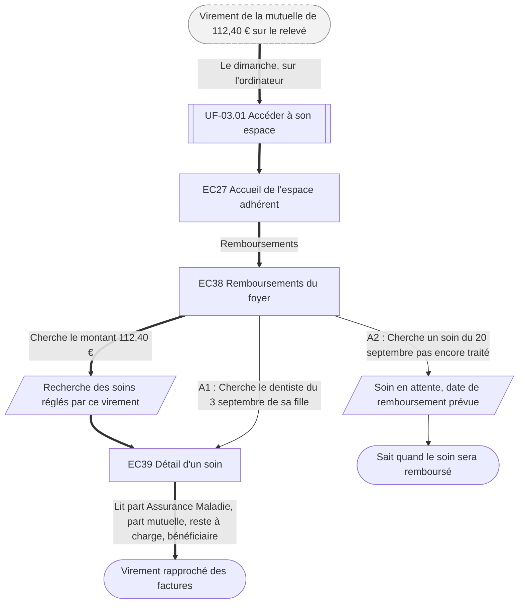

⚠️ Livrable fondé sur des données simulées, sans valeur de recherche.

# UF-05.01 — Retrouver à quel soin correspond un remboursement

> Épopée : [05 Suivre ses remboursements et ses documents](../../04-user-stories/05-suivre-ses-remboursements/00-suivre-ses-remboursements.epic.md) · Persona principal : [Sylvie](../../02-persona/02-sylvie.persona.md) · Variantes : —
> Stories couvertes : [US-05.01](../../04-user-stories/05-suivre-ses-remboursements/01-relier-remboursements-et-soins.story.md)
> Stories mobilisées (autres épopées) : US-03.01 *(renvoi `uf1`)*

- **Déclencheur** : Sylvie voit sur son relevé bancaire un virement de la mutuelle de 112,40 €
- **Fin** : Sylvie a rapproché le virement des factures du foyer
- **Points d'entrée** : relevé bancaire, le dimanche, factures rangées dans une boîte — d'après la [synthèse](../../research/synthese.md#confrontation-aux-hypothèses) (H5) ; aucune journey map dédiée
- **Appareil principal** : ordinateur — d'après « Quand et sur quoi » de la fiche de Sylvie

## Diagramme

<!-- Happy path : flèches épaisses ==> · alternatives et erreurs : --> · variantes : -.-> -->
<!-- Nœuds : écrans = ID d'inventaire (EC05) ; sinon start, fin, d1, s1, x1, v1, uf1. Jamais « end ». -->

## Chemins

| ID | Type | Quand | Suite de nœuds | Issue |
|---|---|---|---|---|
| `HP` | Happy path | Sylvie part d'un virement bancaire | start → uf1 → EC27 → EC38 → s1 → EC39 → fin | Virement rapproché |
| `A1` | Alternatif | Sylvie part d'un soin précis | EC38 → EC39 → fin | Remboursement retrouvé |
| `A2` | Alternatif | Le soin n'est pas encore traité | EC38 → s2 → fin2 | Date prévue connue |

## Étapes du happy path

| # | Écran | Action du persona | Réponse du système | Story |
|---|---|---|---|---|
| 1 | [EC38](../00-index.md#ec38) Remboursements du foyer | Cherche le montant du virement | Retrouve les soins réglés par ce virement | US-05.01 |
| 2 | [EC39](../00-index.md#ec39) Détail d'un soin | Lit le détail | Affiche date, bénéficiaire, parts, reste à charge et date du virement | US-05.01 |

## Couverture des scénarios

| Story | Scénario | Chemin |
|---|---|---|
| US-05.01 | Remboursements retrouvés par soin | `A1` |
| US-05.01 | Soin pas encore remboursé | `A2` |
| US-05.01 | Virement reçu sur le compte bancaire | `HP` |

## Retours vers le backlog

| Type | Story concernée | Proposition | Statut |
|---|---|---|---|
| — | — | Aucun | — |

## Questions ouvertes
- Comment traiter les soins d'un bénéficiaire majeur, non visibles sans son accord (T2) ?
