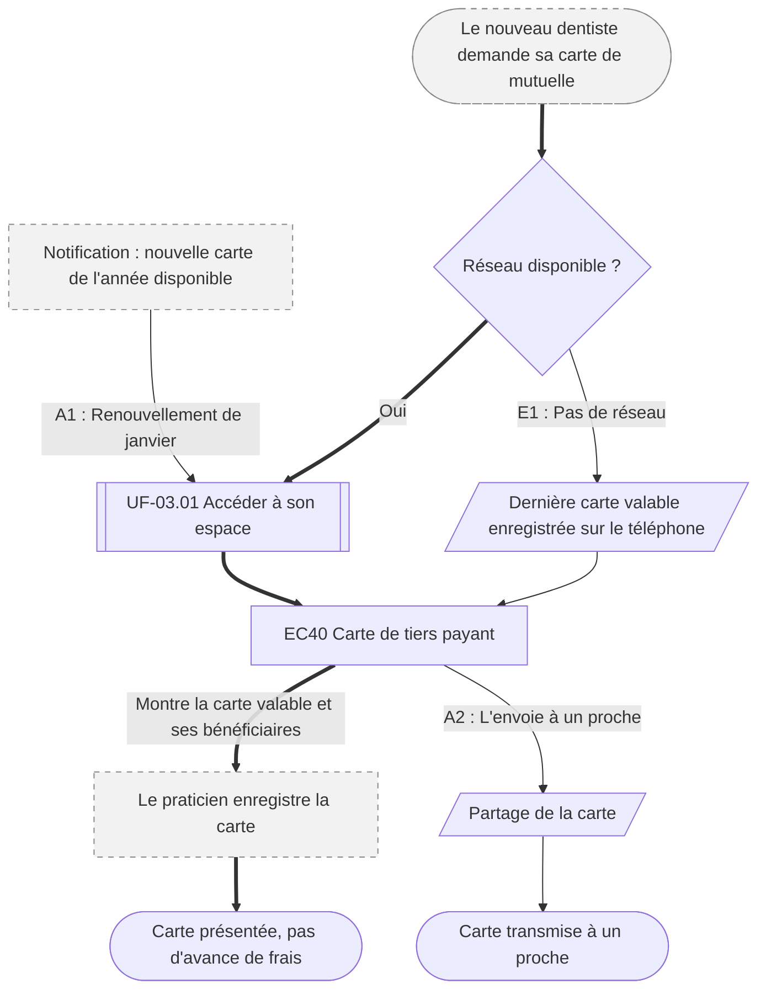

⚠️ Livrable fondé sur des données simulées, sans valeur de recherche.

# UF-05.02 — Présenter sa carte de tiers payant

> Épopée : [05 Suivre ses remboursements et ses documents](../../04-user-stories/05-suivre-ses-remboursements/00-suivre-ses-remboursements.epic.md) · Persona principal : [Manon](../../02-persona/01-manon.persona.md) · Variantes : —
> Stories couvertes : [US-05.02](../../04-user-stories/05-suivre-ses-remboursements/02-presenter-sa-carte-de-tiers-payant.story.md)
> Stories mobilisées (autres épopées) : US-03.01 *(renvoi `uf1`)*

- **Déclencheur** : un nouveau praticien demande sa carte de mutuelle ; ou la nouvelle carte de janvier est disponible
- **Fin** : la carte valable a été présentée et enregistrée
- **Points d'entrée** : comptoir du praticien ou de la pharmacie ; notification « nouvelle carte disponible » — d'après la [synthèse](../../research/synthese.md#confrontation-aux-hypothèses) (H6) ; aucune journey map dédiée
- **Appareil principal** : mobile

## Diagramme

<!-- Happy path : flèches épaisses ==> · alternatives et erreurs : --> · variantes : -.-> -->
<!-- Nœuds : écrans = ID d'inventaire (EC05) ; sinon start, fin, d1, s1, x1, v1, uf1. Jamais « end ». -->

## Chemins

| ID | Type | Quand | Suite de nœuds | Issue |
|---|---|---|---|---|
| `HP` | Happy path | Nouveau praticien, réseau disponible | start → d1 → uf1 → EC40 → x1 → fin | Carte présentée |
| `A1` | Alternatif | Nouvelle carte de l'année | x2 → uf1 → EC40 | Carte de l'année en cours, sans recherche |
| `E1` | Erreur | Pas de réseau au comptoir | d1 → s1 → EC40 | Dernière carte valable présentée |
| `A2` | Alternatif | Un proche en a besoin | EC40 → s2 → fin2 | Carte transmise |

## Étapes du happy path

| # | Écran | Action du persona | Réponse du système | Story |
|---|---|---|---|---|
| 1 | — (renvoi UF-03.01) | Ouvre son espace, appareil mémorisé | — | US-03.01 |
| 2 | [EC40](../00-index.md#ec40) Carte de tiers payant | Montre la carte | Affiche la carte valable et les bénéficiaires | US-05.02 |

## Couverture des scénarios

| Story | Scénario | Chemin |
|---|---|---|
| US-05.02 | Carte présentée chez un nouveau praticien | `HP` |
| US-05.02 | Renouvellement de janvier | `A1` |
| US-05.02 | Sans connexion internet | `E1` |
| US-05.02 | Carte transmise à un proche | `A2` |

## Retours vers le backlog

| Type | Story concernée | Proposition | Statut |
|---|---|---|---|
| scénario manquant | US-05.02 | `A2` : « Étant donné que le conjoint de Manon a besoin de la carte chez le pharmacien, Quand Manon la lui transmet, Alors il peut la présenter depuis son propre téléphone » (contrainte déjà notée dans la story) | accepté |

## Questions ouvertes
- La carte doit-elle être accessible sans connexion complète (appareil mémorisé) ?
