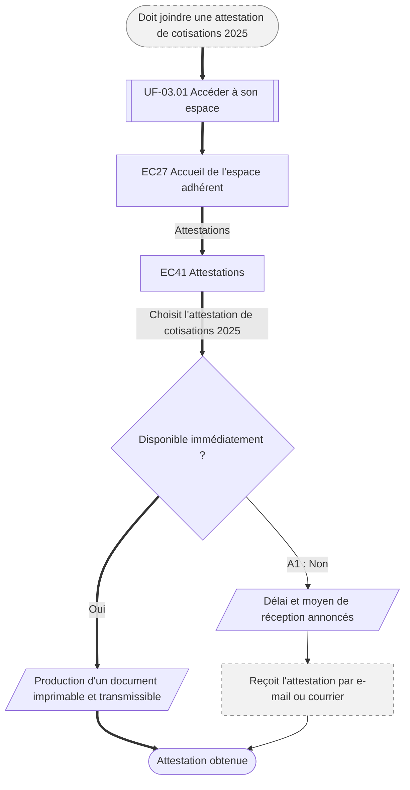

⚠️ Livrable fondé sur des données simulées, sans valeur de recherche.

# UF-05.03 — Obtenir une attestation

> Épopée : [05 Suivre ses remboursements et ses documents](../../04-user-stories/05-suivre-ses-remboursements/00-suivre-ses-remboursements.epic.md) · Persona principal : [Sylvie](../../02-persona/02-sylvie.persona.md) · Variantes : —
> Stories couvertes : [US-05.03](../../04-user-stories/05-suivre-ses-remboursements/03-obtenir-une-attestation.story.md)
> Stories mobilisées (autres épopées) : US-03.01 *(renvoi `uf1`)*

- **Déclencheur** : Sylvie doit fournir une attestation de cotisations 2025 pour la déclaration de revenus du foyer
- **Fin** : Sylvie a l'attestation, ou sait quand elle l'aura
- **Points d'entrée** : démarche administrative extérieure (déclaration de revenus) — d'après la vision ; aucune journey map dédiée
- **Appareil principal** : ordinateur

## Diagramme

<!-- Happy path : flèches épaisses ==> · alternatives et erreurs : --> · variantes : -.-> -->
<!-- Nœuds : écrans = ID d'inventaire (EC05) ; sinon start, fin, d1, s1, x1, v1, uf1. Jamais « end ». -->

## Chemins

| ID | Type | Quand | Suite de nœuds | Issue |
|---|---|---|---|---|
| `HP` | Happy path | L'attestation est produite automatiquement | start → uf1 → EC27 → EC41 → d1 → s1 → fin | Attestation immédiate |
| `A1` | Alternatif | L'attestation n'est pas disponible en ligne | d1 → s2 → x1 → fin | Reçue plus tard, délai connu |

## Étapes du happy path

| # | Écran | Action du persona | Réponse du système | Story |
|---|---|---|---|---|
| 1 | [EC41](../00-index.md#ec41) Attestations | Choisit le type et l'année | Produit l'attestation | US-05.03 |

## Couverture des scénarios

| Story | Scénario | Chemin |
|---|---|---|
| US-05.03 | Attestation obtenue | `HP` |
| US-05.03 | Attestation non disponible en ligne | `A1` |

## Retours vers le backlog

| Type | Story concernée | Proposition | Statut |
|---|---|---|---|
| — | — | Aucun | — |

## Questions ouvertes
- Liste des attestations produites automatiquement.
