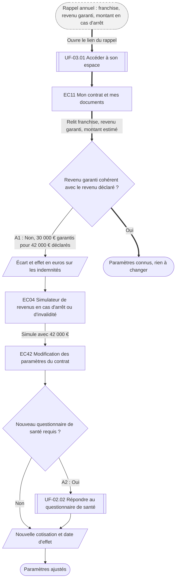

⚠️ Livrable fondé sur des données simulées, sans valeur de recherche.

# UF-05.04 — Ajuster ses garanties après le rappel annuel

> Épopée : [05 Suivre ses remboursements et ses documents](../../04-user-stories/05-suivre-ses-remboursements/00-suivre-ses-remboursements.epic.md) · Persona principal : [Hélène](../../02-persona/03-helene.persona.md) · Variantes : —
> Stories couvertes : [US-05.04](../../04-user-stories/05-suivre-ses-remboursements/04-recevoir-le-rappel-annuel-du-contrat.story.md) *(V2)*
> Stories mobilisées (autres épopées) : [US-01.03](../../04-user-stories/01-comprendre-et-comparer-une-offre/03-simuler-ses-indemnites.story.md) *(simulation dessinée ici)*, US-03.01 *(renvoi `uf1`)*, US-02.03 *(renvoi `uf2`)*

- **Déclencheur** : rappel annuel reçu à la date anniversaire du contrat
- **Fin** : Hélène connaît ses paramètres et les a ajustés si besoin
- **Points d'entrée** : e-mail de rappel annuel — d'après [Déclarer un arrêt et suivre les indemnités](../../03-customer-journey-map/03-helene.cjm.md#déclarer-un-arrêt-et-suivre-les-indemnités-jusquà-la-reprise) (franchise découverte au sinistre)
- **Appareil principal** : ordinateur

## Diagramme

<!-- Happy path : flèches épaisses ==> · alternatives et erreurs : --> · variantes : -.-> -->
<!-- Nœuds : écrans = ID d'inventaire (EC05) ; sinon start, fin, d1, s1, x1, v1, uf1. Jamais « end ». -->

## Chemins

| ID | Type | Quand | Suite de nœuds | Issue |
|---|---|---|---|---|
| `HP` | Happy path | Les paramètres restent adaptés | start → uf1 → EC11 → d1 → fin | Paramètres connus |
| `A1` | Alternatif | Revenu garanti sous-évalué, modification sans questionnaire | d1 → s1 → EC04 → EC42 → d2 → s2 → fin2 | Paramètres ajustés |
| `A2` | Alternatif | La hausse de garantie exige un questionnaire de santé | d2 → uf2 → s2 → fin2 | Paramètres ajustés après questionnaire |

## Étapes du happy path

| # | Écran | Action du persona | Réponse du système | Story |
|---|---|---|---|---|
| 1 | — (e-mail) | Ouvre le rappel | — | US-05.04 |
| 2 | [EC11](../00-index.md#ec11) Mon contrat et mes documents | Relit ses paramètres | Affiche franchise, revenu garanti et montant mensuel estimé, et comment les modifier | US-05.04 |

## Couverture des scénarios

| Story | Scénario | Chemin |
|---|---|---|
| US-05.04 | Rappel annuel | `HP` |
| US-05.04 | Revenu garanti en décalage avec le revenu déclaré | `A1` |
| US-05.04 | Hausse de garantie soumise à un questionnaire de santé | `A2` |
| US-01.03 *(mobilisée)* | Effet d'un revenu garanti sous-évalué | `A1` |

## Retours vers le backlog

| Type | Story concernée | Proposition | Statut |
|---|---|---|---|
| scénario manquant | US-05.04 | `A2` : « Étant donné qu'Hélène augmente son revenu garanti, Quand cette hausse nécessite un questionnaire de santé, Alors elle le sait avant de valider, Et la nouvelle cotisation ne s'applique qu'après acceptation » | accepté |

## Questions ouvertes
- La baisse de la franchise doit-elle aussi déclencher un questionnaire de santé ?
