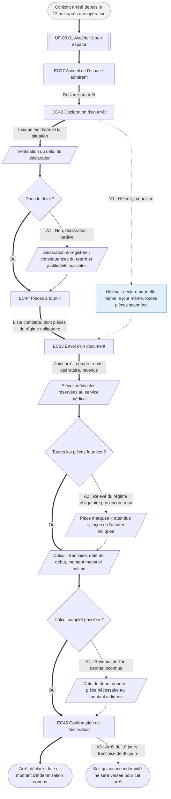

⚠️ Livrable fondé sur des données simulées, sans valeur de recherche.

# UF-06.01 — Déclarer un arrêt et savoir quand on sera indemnisé

> Épopée : [06 Déclarer un arrêt de travail](../../04-user-stories/06-declarer-un-arret-de-travail/00-declarer-un-arret-de-travail.epic.md) · Persona principal : [Sylvie](../../02-persona/02-sylvie.persona.md) · Variantes : [Hélène](../../02-persona/03-helene.persona.md)
> Stories couvertes : [US-06.01](../../04-user-stories/06-declarer-un-arret-de-travail/01-declarer-un-arret.story.md), [US-06.02](../../04-user-stories/06-declarer-un-arret-de-travail/02-connaitre-le-debut-de-l-indemnisation.story.md)
> Stories mobilisées (autres épopées) : US-03.01 *(renvoi `uf1`)*

- **Déclencheur** : le conjoint de Sylvie est arrêté depuis le 12 mai après une opération
- **Fin** : l'arrêt est déclaré ; Sylvie connaît les pièces encore attendues, la date de début et le montant estimé de l'indemnisation
- **Points d'entrée** : remarque du kinésithérapeute (« vous avez une prévoyance ? »), arrêt de travail papier — d'après [Déclarer l'arrêt de son conjoint](../../03-customer-journey-map/02-sylvie.cjm.md#déclarer-larrêt-de-son-conjoint-et-suivre-les-versements) et [Déclarer un arrêt et suivre les indemnités](../../03-customer-journey-map/03-helene.cjm.md#déclarer-un-arrêt-et-suivre-les-indemnités-jusquà-la-reprise)
- **Appareil principal** : tablette pour Sylvie (accès du titulaire au MVP, accès délégué en V2) ; ordinateur pour Hélène

## Diagramme

<!-- Happy path : flèches épaisses ==> · alternatives et erreurs : --> · variantes : -.-> -->
<!-- Nœuds : écrans = ID d'inventaire (EC05) ; sinon start, fin, d1, s1, x1, v1, uf1. Jamais « end ». -->

## Chemins

| ID | Type | Quand | Suite de nœuds | Issue |
|---|---|---|---|---|
| `HP` | Happy path | Déclaration dans le délai, toutes les pièces fournies | start → uf1 → EC27 → EC43 → s1 → d1 → EC44 → EC33 → s2 → d2 → s3 → d3 → EC45 → fin | Date et montant connus |
| `A1` | Alternatif | Déclaration hors délai | d1 → s4 → EC44 | Rejoint le happy path, conséquences connues |
| `A2` | Alternatif | Une pièce n'est pas encore disponible | d2 → s5 → s3 | Rejoint le happy path, pièce attendue (suite : UF-06.02) |
| `A3` | Alternatif | Arrêt plus court que la franchise | EC45 → fin2 | Aucune indemnité, arrêt pris en compte en cas de rechute |
| `A4` | Alternatif | Revenus inconnus de l'assureur | d3 → s6 → EC45 | Date connue, montant après la pièce |
| `V1` | Variante Hélène | Déclare tout le jour même `[SIM-P08]` | EC43 → v1 → EC33 | Rejoint le happy path |

## Étapes du happy path

| # | Écran | Action du persona | Réponse du système | Story |
|---|---|---|---|---|
| 1 | [EC43](../00-index.md#ec43) Déclaration d'un arrêt | Indique dates et situation | Vérifie le délai de déclaration | US-06.01 |
| 2 | [EC44](../00-index.md#ec44) Pièces à fournir | Lit la liste complète | Indique la date limite et toutes les pièces, dont celles à demander au régime obligatoire | US-06.01 |
| 3 | [EC33](../00-index.md#ec33) Envoi d'un document | Joint les pièces | Indique que seul le service médical lit les pièces médicales | US-06.01 |
| 4 | [EC45](../00-index.md#ec45) Confirmation de déclaration | Lit le résultat | Indique franchise, date de début (ex. 6 avril pour un arrêt du 6 janvier et 90 jours de franchise) et montant mensuel estimé | US-06.02 |

## Couverture des scénarios

| Story | Scénario | Chemin |
|---|---|---|
| US-06.01 | Déclaration d'un arrêt avec la liste des pièces | `HP` |
| US-06.01 | Déclaration hors délai | `A1` |
| US-06.01 | Pièce envoyée plus tard | `A2` |
| US-06.01 | Pièces médicales protégées | `HP` |
| US-06.02 | Indemnisation annoncée à la déclaration | `HP` |
| US-06.02 | Arrêt plus court que la franchise | `A3` |
| US-06.02 | Estimation impossible faute de revenus connus | `A4` |

## Retours vers le backlog

| Type | Story concernée | Proposition | Statut |
|---|---|---|---|
| — | — | Aucun | — |

## Questions ouvertes
- Au MVP, Sylvie déclare avec l'accès du titulaire : à revoir avec US-03.02 en V2.
