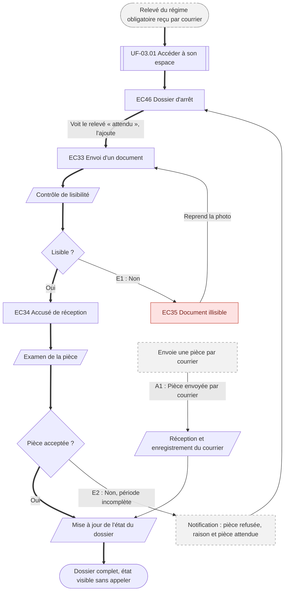

⚠️ Livrable fondé sur des données simulées, sans valeur de recherche.

# UF-06.02 — Compléter le dossier d'arrêt

> Épopée : [06 Déclarer un arrêt de travail](../../04-user-stories/06-declarer-un-arret-de-travail/00-declarer-un-arret-de-travail.epic.md) · Persona principal : [Sylvie](../../02-persona/02-sylvie.persona.md) · Variantes : —
> Stories couvertes : [US-06.03](../../04-user-stories/06-declarer-un-arret-de-travail/03-suivre-les-pieces-du-dossier.story.md)
> Stories mobilisées (autres épopées) : US-03.01 *(renvoi `uf1`)*

- **Déclencheur** : Sylvie a reçu le relevé du régime obligatoire, pièce encore attendue
- **Fin** : le dossier est complet et Sylvie le sait sans appeler
- **Points d'entrée** : relevé reçu par courrier ; notification de pièce refusée ; envoi postal — d'après [Déclarer l'arrêt de son conjoint](../../03-customer-journey-map/02-sylvie.cjm.md#déclarer-larrêt-de-son-conjoint-et-suivre-les-versements)
- **Appareil principal** : tablette

## Diagramme

<!-- Happy path : flèches épaisses ==> · alternatives et erreurs : --> · variantes : -.-> -->
<!-- Nœuds : écrans = ID d'inventaire (EC05) ; sinon start, fin, d1, s1, x1, v1, uf1. Jamais « end ». -->

## Chemins

| ID | Type | Quand | Suite de nœuds | Issue |
|---|---|---|---|---|
| `HP` | Happy path | Pièce lisible et acceptée | start → uf1 → EC46 → EC33 → s1 → d1 → EC34 → s2 → d2 → s3 → fin | Dossier complet |
| `E1` | Erreur | Photo illisible | d1 → EC35 → EC33 | Nouvelle photo |
| `E2` | Erreur | Pièce refusée | d2 → x2 → EC46 | Raison et pièce attendue connues, nouvel envoi |
| `A1` | Alternatif | Pièce envoyée par courrier | x3 → s4 → s3 → fin | État mis à jour sans appel |

## Étapes du happy path

| # | Écran | Action du persona | Réponse du système | Story |
|---|---|---|---|---|
| 1 | [EC46](../00-index.md#ec46) Dossier d'arrêt | Consulte l'état des pièces | Indique pièces reçues, acceptées et attendues ; contenu médical non affiché | US-06.03 |
| 2 | [EC33](../00-index.md#ec33) Envoi d'un document | Ajoute le relevé | Vérifie la lisibilité | US-06.03 |
| 3 | [EC34](../00-index.md#ec34) Accusé de réception | — | Confirme la réception | US-06.03 |

## Couverture des scénarios

| Story | Scénario | Chemin |
|---|---|---|
| US-06.03 | État des pièces | `HP` |
| US-06.03 | Pièce refusée | `E2` |
| US-06.03 | Pièce annoncée manquante alors qu'envoyée par courrier | `A1` |
| US-06.03 | Pièce illisible | `E1` |

## Retours vers le backlog

| Type | Story concernée | Proposition | Statut |
|---|---|---|---|
| scénario manquant | US-06.03 | `E1` : « Étant donné que Sylvie transmet une photo floue d'une pièce, Quand la pièce est vérifiée, Alors elle est informée qu'elle n'est pas lisible, Et peut en transmettre une nouvelle » | accepté |

## Questions ouvertes
- Délai d'enregistrement des pièces reçues par courrier.
