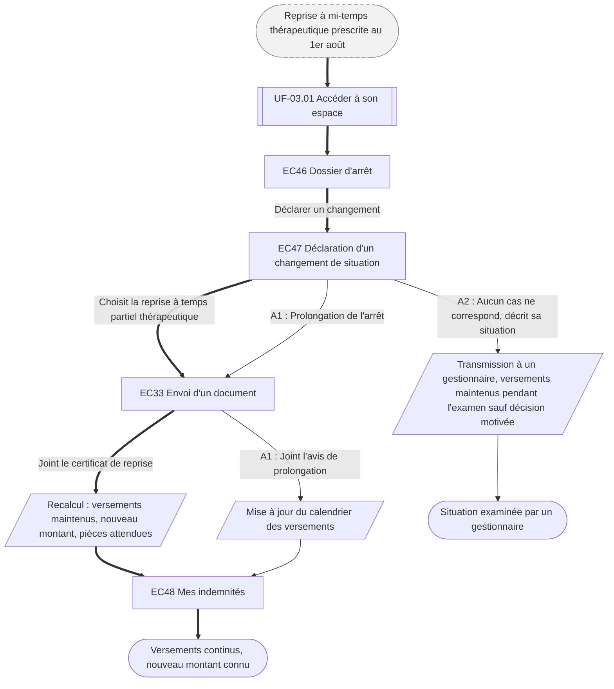

⚠️ Livrable fondé sur des données simulées, sans valeur de recherche.

# UF-06.03 — Déclarer une reprise à temps partiel ou une prolongation

> Épopée : [06 Déclarer un arrêt de travail](../../04-user-stories/06-declarer-un-arret-de-travail/00-declarer-un-arret-de-travail.epic.md) · Persona principal : [Hélène](../../02-persona/03-helene.persona.md) · Variantes : —
> Stories couvertes : [US-06.04](../../04-user-stories/06-declarer-un-arret-de-travail/04-declarer-une-reprise-a-temps-partiel.story.md)
> Stories mobilisées (autres épopées) : US-03.01 *(renvoi `uf1`)*

- **Déclencheur** : le médecin prescrit à Hélène une reprise à mi-temps thérapeutique à partir du 1er août
- **Fin** : la reprise est déclarée, les versements continuent, le nouveau montant est connu
- **Points d'entrée** : prescription du médecin (papier) — d'après [Déclarer un arrêt et suivre les indemnités](../../03-customer-journey-map/03-helene.cjm.md#déclarer-un-arrêt-et-suivre-les-indemnités-jusquà-la-reprise), étape « Déclarer la reprise partielle »
- **Appareil principal** : ordinateur

## Diagramme

<!-- Happy path : flèches épaisses ==> · alternatives et erreurs : --> · variantes : -.-> -->
<!-- Nœuds : écrans = ID d'inventaire (EC05) ; sinon start, fin, d1, s1, x1, v1, uf1. Jamais « end ». -->

## Chemins

| ID | Type | Quand | Suite de nœuds | Issue |
|---|---|---|---|---|
| `HP` | Happy path | Reprise à temps partiel thérapeutique | start → uf1 → EC46 → EC47 → EC33 → s1 → EC48 → fin | Versements continus |
| `A1` | Alternatif | Prolongation de l'arrêt | EC47 → EC33 → s2 → EC48 → fin | Calendrier mis à jour |
| `A2` | Alternatif | Situation non prévue | EC47 → s3 → fin2 | Examen par un gestionnaire, versements maintenus |

## Étapes du happy path

| # | Écran | Action du persona | Réponse du système | Story |
|---|---|---|---|---|
| 1 | [EC46](../00-index.md#ec46) Dossier d'arrêt | Choisit de déclarer un changement | — | US-06.04 |
| 2 | [EC47](../00-index.md#ec47) Déclaration d'un changement de situation | Choisit « reprise à temps partiel thérapeutique » | Indique les pièces attendues | US-06.04 |
| 3 | [EC33](../00-index.md#ec33) Envoi d'un document | Joint le certificat | Transmet au service médical | US-06.04 |
| 4 | [EC48](../00-index.md#ec48) Mes indemnités | Lit le nouveau montant | Confirme que les versements continuent | US-06.04 |

## Couverture des scénarios

| Story | Scénario | Chemin |
|---|---|---|
| US-06.04 | Reprise à temps partiel thérapeutique | `HP` |
| US-06.04 | Prolongation d'arrêt | `A1` |
| US-06.04 | Situation non prévue | `A2` |

## Retours vers le backlog

| Type | Story concernée | Proposition | Statut |
|---|---|---|---|
| — | — | Aucun | — |

## Questions ouvertes
- Maintien des versements pendant l'examen : décision métier à confirmer.
