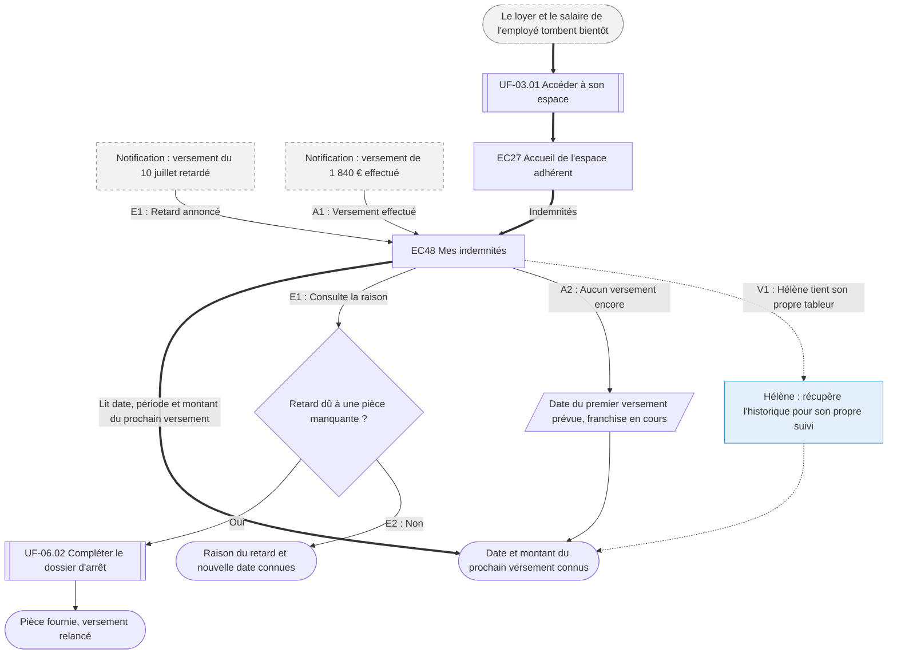

⚠️ Livrable fondé sur des données simulées, sans valeur de recherche.

# UF-07.01 — Savoir quand et combien on sera payé

> Épopée : [07 Suivre ses indemnités](../../04-user-stories/07-suivre-ses-indemnites/00-suivre-ses-indemnites.epic.md) · Persona principal : [Sylvie](../../02-persona/02-sylvie.persona.md) · Variantes : [Hélène](../../02-persona/03-helene.persona.md)
> Stories couvertes : [US-07.01](../../04-user-stories/07-suivre-ses-indemnites/01-connaitre-le-prochain-versement.story.md)
> Stories mobilisées (autres épopées) : US-03.01 *(renvoi `uf1`)*, US-06.03 *(renvoi `uf2`)*

- **Déclencheur** : le loyer et le salaire de l'employé tombent bientôt ; ou une notification de versement ou de retard arrive
- **Fin** : Sylvie connaît la date et le montant du prochain versement, ou la raison du retard
- **Points d'entrée** : échéance de trésorerie ; notifications de versement et de retard — d'après [Déclarer l'arrêt de son conjoint](../../03-customer-journey-map/02-sylvie.cjm.md#déclarer-larrêt-de-son-conjoint-et-suivre-les-versements), étape « Attendre et relancer »
- **Appareil principal** : tablette pour Sylvie, ordinateur pour Hélène

## Diagramme

<!-- Happy path : flèches épaisses ==> · alternatives et erreurs : --> · variantes : -.-> -->
<!-- Nœuds : écrans = ID d'inventaire (EC05) ; sinon start, fin, d1, s1, x1, v1, uf1. Jamais « end ». -->

## Chemins

| ID | Type | Quand | Suite de nœuds | Issue |
|---|---|---|---|---|
| `HP` | Happy path | Dossier complet, Sylvie anticipe | start → uf1 → EC27 → EC48 → fin | Prochain versement connu |
| `E1` | Erreur | Retard dû à une pièce manquante | x1 → EC48 → d1 → uf2 → fin2 | Pièce fournie |
| `E2` | Erreur | Retard pour une autre raison | x1 → EC48 → d1 → fin3 | Raison et nouvelle date connues |
| `A1` | Alternatif | Un versement vient d'être fait | x2 → EC48 → fin | Montant relié à sa période |
| `A2` | Alternatif | Aucun versement encore (franchise en cours) | EC48 → s1 → fin | Date du premier versement connue |
| `V1` | Variante Hélène | Suit ses versements dans un tableur `[SIM-P08]` | EC48 → v1 → fin | Historique récupéré |

## Étapes du happy path

| # | Écran | Action du persona | Réponse du système | Story |
|---|---|---|---|---|
| 1 | [EC48](../00-index.md#ec48) Mes indemnités | Consulte | Affiche date prévue, période couverte et montant du prochain versement, et les versements passés | US-07.01 |

## Couverture des scénarios

| Story | Scénario | Chemin |
|---|---|---|
| US-07.01 | Prochain versement connu | `HP` |
| US-07.01 | Versement retardé | `E1`, `E2` |
| US-07.01 | Versement effectué | `A1` |
| US-07.01 | Franchise en cours | `A2` |

## Retours vers le backlog

| Type | Story concernée | Proposition | Statut |
|---|---|---|---|
| scénario manquant | US-07.01 | `A2` : « Étant donné que la franchise de l'arrêt court encore, Quand Sylvie consulte les indemnités, Alors elle sait qu'aucun versement n'est dû avant la fin de la franchise, Et connaît la date prévue du premier versement » | accepté |
| scénario manquant | US-07.01 | `V1` : « Étant donné qu'Hélène suit ses versements dans son propre tableur, Quand elle veut l'historique, Alors elle peut récupérer la liste des versements avec dates, périodes et montants » | *refusé* |

## Questions ouvertes
- Peut-on s'engager sur une date de versement fixe chaque mois ?
