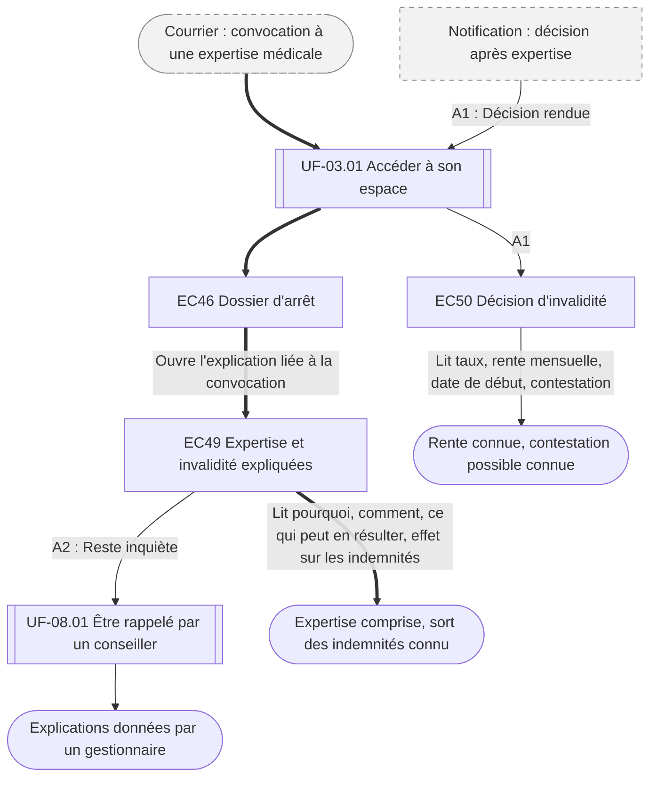

⚠️ Livrable fondé sur des données simulées, sans valeur de recherche.

# UF-07.02 — Comprendre une expertise ou un passage en invalidité

> Épopée : [07 Suivre ses indemnités](../../04-user-stories/07-suivre-ses-indemnites/00-suivre-ses-indemnites.epic.md) · Persona principal : [Sylvie](../../02-persona/02-sylvie.persona.md) · Variantes : —
> Stories couvertes : [US-07.02](../../04-user-stories/07-suivre-ses-indemnites/02-comprendre-le-passage-en-invalidite.story.md) *(V2)*
> Stories mobilisées (autres épopées) : US-03.01 *(renvoi `uf1`)*, US-08.01 *(renvoi `uf2`)*

- **Déclencheur** : un courrier convoque le conjoint de Sylvie à une expertise médicale
- **Fin** : Sylvie comprend ce qui va se passer et ce que cela change pour les revenus du foyer
- **Points d'entrée** : courrier de convocation ; notification de décision — d'après [Déclarer l'arrêt de son conjoint](../../03-customer-journey-map/02-sylvie.cjm.md#déclarer-larrêt-de-son-conjoint-et-suivre-les-versements), étape « Après plusieurs mois »
- **Appareil principal** : tablette

## Diagramme

<!-- Happy path : flèches épaisses ==> · alternatives et erreurs : --> · variantes : -.-> -->
<!-- Nœuds : écrans = ID d'inventaire (EC05) ; sinon start, fin, d1, s1, x1, v1, uf1. Jamais « end ». -->

## Chemins

| ID | Type | Quand | Suite de nœuds | Issue |
|---|---|---|---|---|
| `HP` | Happy path | Convocation à une expertise | start → uf1 → EC46 → EC49 → fin | Expertise comprise |
| `A1` | Alternatif | La décision d'invalidité est rendue | x1 → uf1 → EC50 → fin2 | Rente et contestation connues |
| `A2` | Alternatif | Sylvie a besoin d'en parler | EC49 → uf2 → fin3 | Rappel par un gestionnaire |

## Étapes du happy path

| # | Écran | Action du persona | Réponse du système | Story |
|---|---|---|---|---|
| 1 | [EC46](../00-index.md#ec46) Dossier d'arrêt | Voit l'expertise annoncée | — | US-07.02 |
| 2 | [EC49](../00-index.md#ec49) Expertise et invalidité expliquées | Lit | Explique l'expertise, ses suites possibles et le sort des indemnités pendant l'examen | US-07.02 |

## Couverture des scénarios

| Story | Scénario | Chemin |
|---|---|---|
| US-07.02 | Convocation à une expertise | `HP` |
| US-07.02 | Passage en invalidité | `A1` |
| US-07.02 | Besoin d'en parler | `A2` |

## Retours vers le backlog

| Type | Story concernée | Proposition | Statut |
|---|---|---|---|
| — | — | Aucun | — |

## Questions ouvertes
- Les conclusions médicales détaillées restent réservées à l'assuré : que voit Sylvie avec un accès délégué ?
