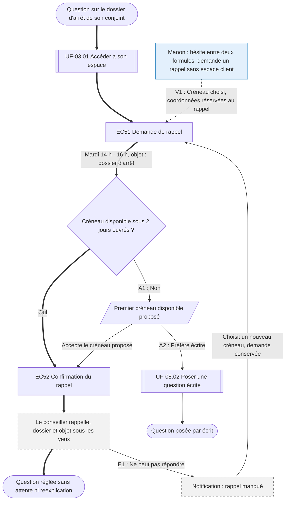

⚠️ Livrable fondé sur des données simulées, sans valeur de recherche.

# UF-08.01 — Être rappelé par un conseiller qui connaît le dossier

> Épopée : [08 Être accompagné par un conseiller](../../04-user-stories/08-etre-accompagne-par-un-conseiller/00-etre-accompagne-par-un-conseiller.epic.md) · Persona principal : [Sylvie](../../02-persona/02-sylvie.persona.md) · Variantes : [Manon](../../02-persona/01-manon.persona.md)
> Stories couvertes : [US-08.01](../../04-user-stories/08-etre-accompagne-par-un-conseiller/01-etre-rappele-par-un-conseiller.story.md)
> Stories mobilisées (autres épopées) : US-03.01 *(renvoi `uf1`)*

- **Déclencheur** : Sylvie a une question sur le dossier d'arrêt de son conjoint
- **Fin** : un conseiller qui connaît le dossier la rappelle sur le créneau choisi
- **Points d'entrée** : dossier en ligne, renvois depuis les autres flows quand le parcours bloque — d'après [Déclarer l'arrêt de son conjoint](../../03-customer-journey-map/02-sylvie.cjm.md#déclarer-larrêt-de-son-conjoint-et-suivre-les-versements), étape « Attendre et relancer »
- **Appareil principal** : tablette ; le rappel se fait par téléphone

## Diagramme

<!-- Happy path : flèches épaisses ==> · alternatives et erreurs : --> · variantes : -.-> -->
<!-- Nœuds : écrans = ID d'inventaire (EC05) ; sinon start, fin, d1, s1, x1, v1, uf1. Jamais « end ». -->

## Chemins

| ID | Type | Quand | Suite de nœuds | Issue |
|---|---|---|---|---|
| `HP` | Happy path | Créneau disponible, Sylvie répond | start → uf1 → EC51 → d1 → EC52 → x1 → fin | Question réglée |
| `A1` | Alternatif | Aucun créneau sous 2 jours, Sylvie accepte le premier disponible | d1 → s1 → EC52 | Rejoint le happy path |
| `A2` | Alternatif | Aucun créneau, Sylvie préfère écrire | d1 → s1 → uf2 → fin2 | Question écrite |
| `E1` | Erreur | Rappel manqué | x1 → x2 → EC51 | Nouveau créneau sans refaire la demande |
| `V1` | Variante Manon | Avant souscription, sans compte `[SIM-P01]` | v1 → EC51 → d1 → EC52 → x1 → fin | Rappel uniquement sur le créneau, sans sollicitation commerciale |

## Étapes du happy path

| # | Écran | Action du persona | Réponse du système | Story |
|---|---|---|---|---|
| 1 | [EC51](../00-index.md#ec51) Demande de rappel | Choisit un créneau et précise l'objet | Vérifie la disponibilité | US-08.01 |
| 2 | [EC52](../00-index.md#ec52) Confirmation du rappel | — | Confirme le créneau, transmet l'objet et l'état du dossier au conseiller | US-08.01 |

## Couverture des scénarios

| Story | Scénario | Chemin |
|---|---|---|
| US-08.01 | Rappel demandé sur un dossier | `HP` |
| US-08.01 | Aucun créneau disponible | `A1`, `A2` |
| US-08.01 | Rappel manqué | `E1` |
| US-08.01 | Demande de rappel avant souscription | `V1` |

## Retours vers le backlog

| Type | Story concernée | Proposition | Statut |
|---|---|---|---|
| — | — | Aucun | — |

## Questions ouvertes
- Plages horaires de rappel garanties.
