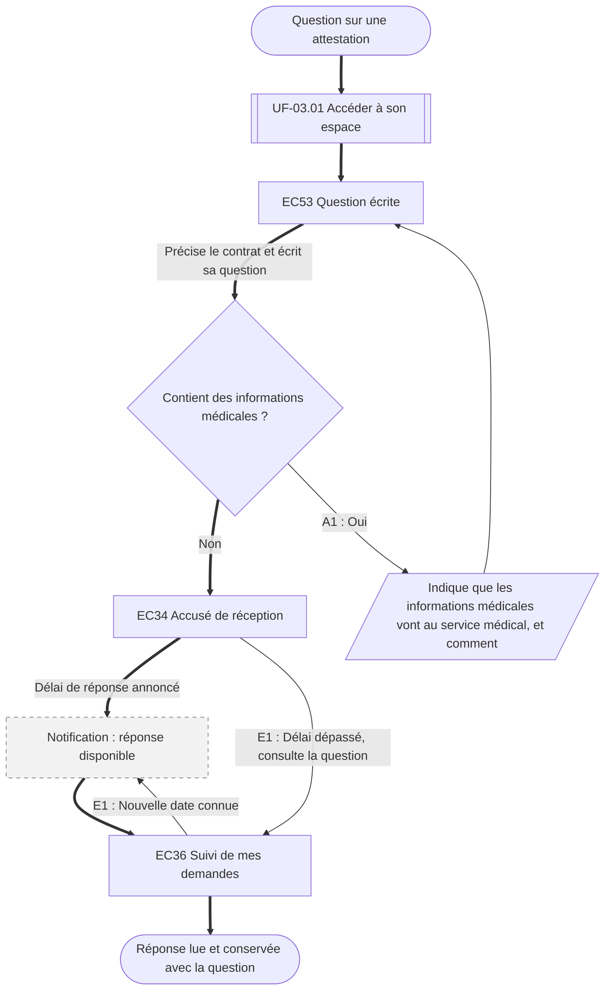

⚠️ Livrable fondé sur des données simulées, sans valeur de recherche.

# UF-08.02 — Poser une question écrite et suivre la réponse

> Épopée : [08 Être accompagné par un conseiller](../../04-user-stories/08-etre-accompagne-par-un-conseiller/00-etre-accompagne-par-un-conseiller.epic.md) · Persona principal : [Sylvie](../../02-persona/02-sylvie.persona.md) · Variantes : —
> Stories couvertes : [US-08.02](../../04-user-stories/08-etre-accompagne-par-un-conseiller/02-poser-une-question-ecrite.story.md)
> Stories mobilisées (autres épopées) : US-03.01 *(renvoi `uf1`)*

- **Déclencheur** : Sylvie a une question sur une attestation et veut une trace écrite
- **Fin** : Sylvie a la réponse, conservée avec sa question
- **Points d'entrée** : espace adhérent ; renvoi depuis UF-08.01 quand aucun créneau n'est disponible — d'après la fiche de Sylvie (classeur des courriers)
- **Appareil principal** : tablette ou ordinateur fixe

## Diagramme

<!-- Happy path : flèches épaisses ==> · alternatives et erreurs : --> · variantes : -.-> -->
<!-- Nœuds : écrans = ID d'inventaire (EC05) ; sinon start, fin, d1, s1, x1, v1, uf1. Jamais « end ». -->

## Chemins

| ID | Type | Quand | Suite de nœuds | Issue |
|---|---|---|---|---|
| `HP` | Happy path | Question sans information médicale, réponse dans le délai | start → uf1 → EC53 → d1 → EC34 → x1 → EC36 → fin | Réponse conservée |
| `A1` | Alternatif | Sylvie mentionne une information médicale | d1 → s1 → EC53 | Reformule ou passe par le service médical |
| `E1` | Erreur | Délai de réponse dépassé | EC34 → EC36 → x1 | Nouvelle date connue |

## Étapes du happy path

| # | Écran | Action du persona | Réponse du système | Story |
|---|---|---|---|---|
| 1 | [EC53](../00-index.md#ec53) Question écrite | Précise le contrat, écrit la question | — | US-08.02 |
| 2 | [EC34](../00-index.md#ec34) Accusé de réception | — | Annonce le délai de réponse | US-08.02 |
| 3 | [EC36](../00-index.md#ec36) Suivi de mes demandes | Lit la réponse | Conserve la question et la réponse | US-08.02 |

## Couverture des scénarios

| Story | Scénario | Chemin |
|---|---|---|
| US-08.02 | Question envoyée | `HP` |
| US-08.02 | Question contenant des informations de santé | `A1` |
| US-08.02 | Réponse en retard | `E1` |

## Retours vers le backlog

| Type | Story concernée | Proposition | Statut |
|---|---|---|---|
| — | — | Aucun | — |

## Questions ouvertes
- Comment repérer les informations médicales dans une question (avertissement systématique ou détection) ?
