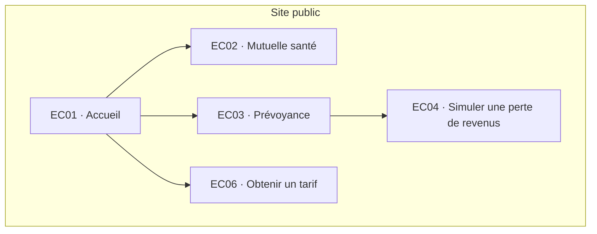
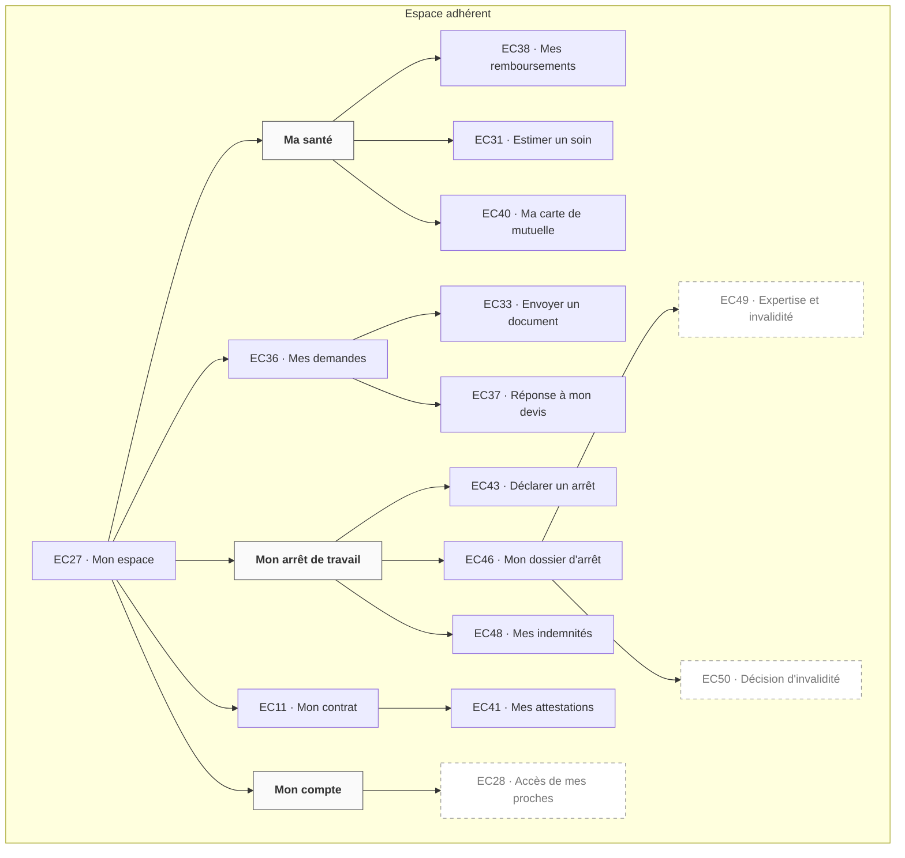
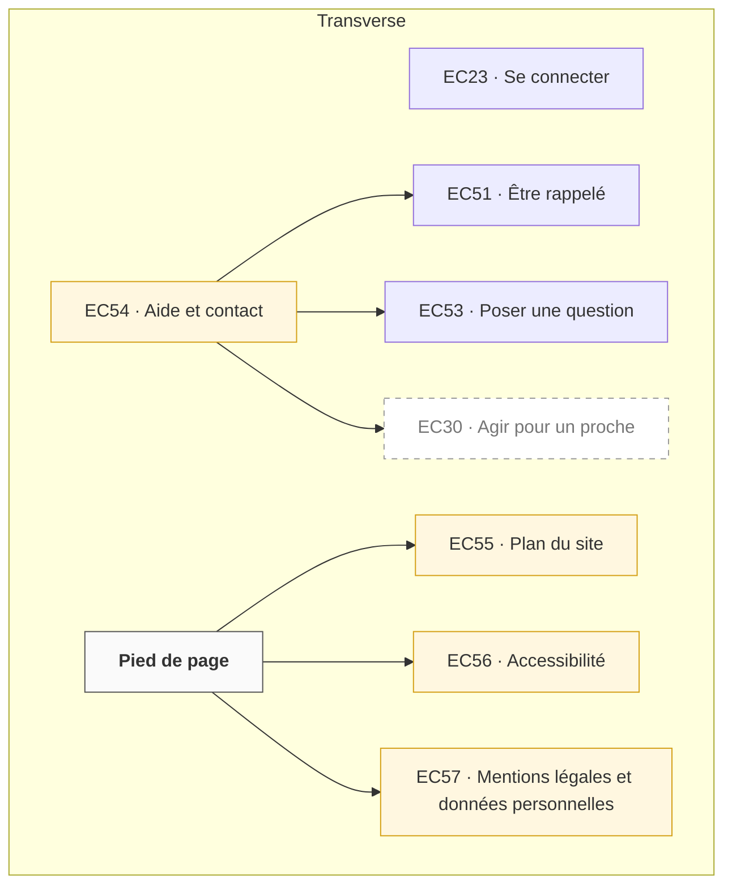

⚠️ Livrable fondé sur des données simulées, sans valeur de recherche.

# Arborescence — Clarea Assurances, site d'assurance complémentaire santé et prévoyance

<!-- Un diagramme par zone. Lieux uniquement, chacun une seule fois. Libellés = glossaire. Flèches = parent → enfant. -->
<!-- Nœuds : écrans = ID d'inventaire (EC04) ; rubriques sans écran r1 ; zones z1. Jamais de nœud « end ». -->

## Vue d'ensemble

| Zone | Schéma d'organisation | Justification | Rubriques de 1er niveau | Profondeur max |
|---|---|---|---|---|
| Site public | par sujet (les offres) | Manon et Hélène arrivent par une offre, depuis un moteur de recherche ou une comparaison ([UF-01.01](../05-user-flows/01-comprendre-et-comparer-une-offre/01-comprendre-ce-que-rembourse-chaque-formule.flow.md), [UF-01.02](../05-user-flows/01-comprendre-et-comparer-une-offre/02-choisir-une-prevoyance.flow.md)) | Mutuelle santé, Prévoyance, Obtenir un tarif | 2 |
| Espace adhérent | par objet, au possessif | Sylvie et Hélène suivent ce qu'elles possèdent : remboursements, demandes, dossier d'arrêt, indemnités, contrat `[SIM-P04][SIM-P07][SIM-P08]` | Ma santé, Mes demandes, Mon arrêt de travail, Mon contrat, Mon compte | 3 |
| Transverse | utilitaire | La connexion, l'aide et le contact servent client ou non, depuis les deux zones ([UF-03.01](../05-user-flows/03-acceder-a-son-espace/01-acceder-a-son-espace.flow.md), [UF-08.01](../05-user-flows/08-etre-accompagne-par-un-conseiller/01-etre-rappele-par-un-conseiller.flow.md)) | Se connecter, Aide et contact, Pied de page | 2 |

## Site public

| Rubrique | Contient | Pourquoi ici |
|---|---|---|
| Mutuelle santé | EC02 | Objet Formule santé, porte d'entrée de Manon |
| Prévoyance | EC03, EC04 | Objet Formule prévoyance ; la simulation complète la comparaison d'Hélène |
| Obtenir un tarif | EC06 | Tâche commune aux deux offres, premier écran de la souscription |

## Espace adhérent

| Rubrique | Contient | Pourquoi ici |
|---|---|---|
| Ma santé | EC38, EC31, EC40 | Objets Soin, Estimation, Carte : ce que Manon et Sylvie cherchent autour d'un soin `[SIM-P01][SIM-P03][SIM-P04]` |
| Mes demandes | EC36, EC33, EC37 | Objet Demande : devis envoyés, questions, réponses ; c'est ici qu'on envoie un document (devis ou pièce) |
| Mon arrêt de travail | EC43, EC46, EC48, EC49, EC50 | Objets Dossier d'arrêt et Indemnité : tout le parcours de Sylvie et d'Hélène pendant un arrêt `[SIM-P07][SIM-P08]` |
| Mon contrat | EC11, EC41 | Objet Contrat : paramètres, conseil reçu, consentements, attestations |
| Mon compte | EC28 | Objet Accès délégué (V2) ; rubrique sans contenu au MVP, présente seulement en utilitaire |

## Transverse

| Rubrique | Contient | Pourquoi ici |
|---|---|---|
| Se connecter | EC23 | Porte de l'espace adhérent, depuis le site public et les liens profonds |
| Aide et contact | EC54, EC51, EC53, EC30 | Issue humaine de 7 flows ; accessible client ou non (variante Manon de [UF-08.01](../05-user-flows/08-etre-accompagne-par-un-conseiller/01-etre-rappele-par-un-conseiller.flow.md)) |
| Pied de page | EC55, EC56, EC57 | Obligations RGAA et RGPD ; le plan du site est le second système de navigation exigé par le RGAA |

## Écrans contextuels

<!-- Rappel : rattachés à leur parent, détail dans l'inventaire. -->

| Parent | Contextuels |
|---|---|
| [EC03](./01-contenus.inventory.md#ec03) Prévoyance | EC05 |
| [EC06](./01-contenus.inventory.md#ec06) Obtenir un tarif | EC07 → EC08 → EC09 ; EC07 → EC10 ; EC09 → EC12 → EC13, EC14 → EC15, EC16 (V2) ; EC15 → EC17 ; EC09 → EC18 → EC19 → EC20 → EC21, EC22 |
| [EC23](./01-contenus.inventory.md#ec23) Se connecter | EC24, EC25, EC26, EC29 (V2) |
| [EC31](./01-contenus.inventory.md#ec31) Estimer un soin | EC32 |
| [EC33](./01-contenus.inventory.md#ec33) Envoyer un document | EC34, EC35 |
| [EC38](./01-contenus.inventory.md#ec38) Mes remboursements | EC39 |
| [EC11](./01-contenus.inventory.md#ec11) Mon contrat | EC42 (V2) |
| [EC43](./01-contenus.inventory.md#ec43) Déclarer un arrêt | EC44, EC45 |
| [EC46](./01-contenus.inventory.md#ec46) Mon dossier d'arrêt | EC47 |
| [EC51](./01-contenus.inventory.md#ec51) Être rappelé | EC52 |

## Écarts aux règles
- EC49 et EC50 sont à 3 niveaux sous Mon espace (Mon arrêt de travail › Mon dossier d'arrêt › …) : dans la limite, et ce sont des tâches V2, en Should.
- La rubrique Mon compte ne contient qu'un écran V2 : elle n'apparaît au MVP que dans la navigation utilitaire (déconnexion).
- Toutes les tâches `Must` du MVP sont à 2 niveaux au plus de l'accueil de leur zone.
